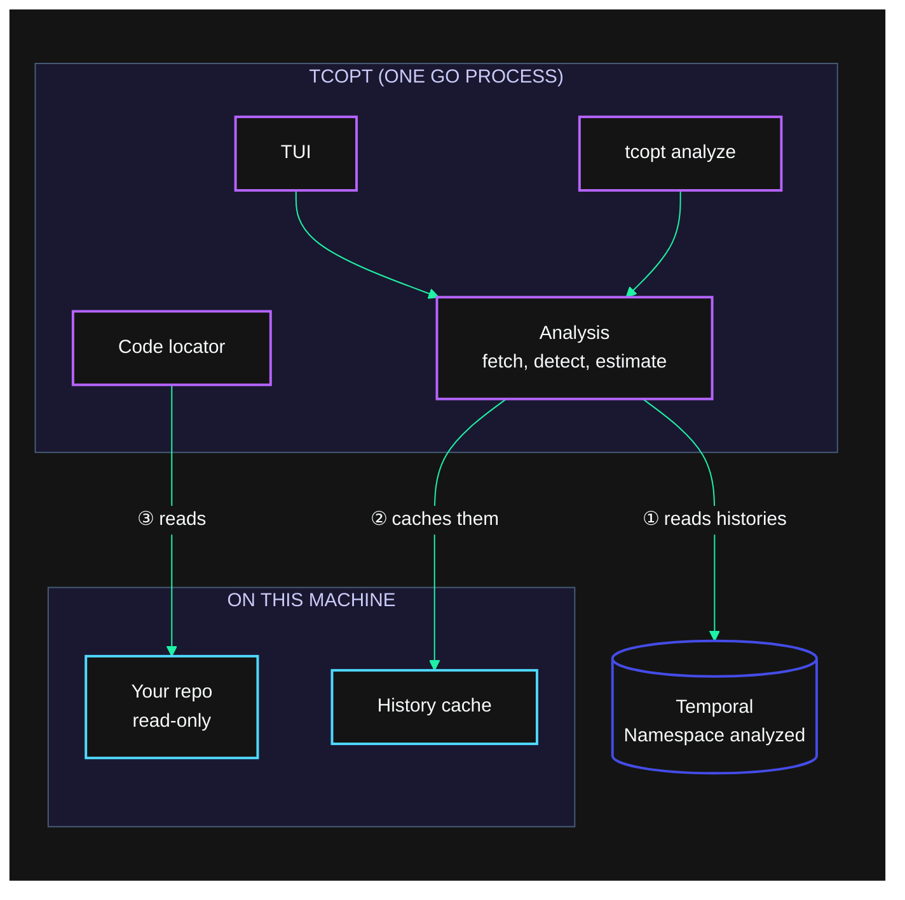
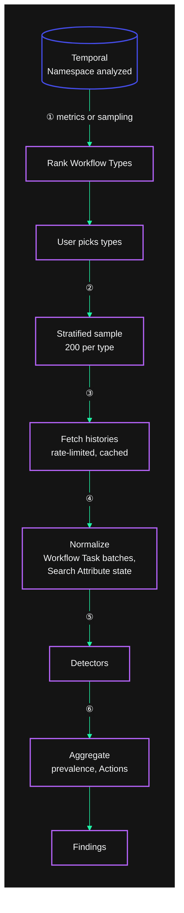
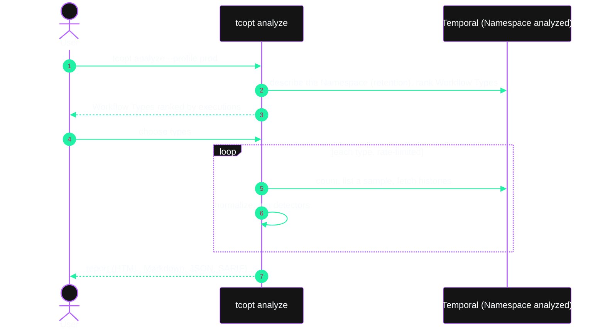

# Temporal cost optimizer: plan and PRD

Status: draft v0.9, 2026-10-28. Owner: Michael Jones. Working name for the binary: `tcopt`.

`tcopt` is a terminal app that reads a Namespace's Workflow histories, finds patterns that waste Temporal Cloud Actions or storage, and shows how much each one costs and how to fix it. It runs on the developer's machine with the Temporal profiles, repos, and toolchains already there. Detection, cost estimates, fix guidance, and code location are deterministic. `tcopt` only reads: it never calls an LLM and never changes code.

Changes in v0.9:
- `tcopt` only reports findings that Event History proves (section 6.4). The Cloud metrics (MET), Namespace and Schedule configuration (CFG), and static code (CODE) checks are gone, along with the history detectors that relied on thresholds, guessed intent, or traded a design property for Actions. Thirteen detectors remain.
- Costs that history can't show are listed as caveats in every report, not findings (section 6.9).
- The coding agent, its investigations, and deterministic codemods are gone. So are the Temporal-orchestrated sessions, the local dev server backend, and the Workflow versioning they needed. The TUI runs the analysis in-process, like `tcopt analyze`.

Changes in v0.8:
- The user chooses the model provider: Anthropic, OpenAI, OpenRouter, a LiteLLM proxy, or any OpenAI-compatible endpoint. Removed with the agent in v0.9.
- Every cost and saving is measured in Actions, or GB-hours for storage. `tcopt` shows no currency figures and has no price setting.
- Running `tcopt` opens the TUI, and setup happens inside it, including a browser login to Temporal Cloud that creates a short-lived API key (section 8.1). `tcopt` calls the Cloud Ops API itself instead of running `tcld`.

Changes in v0.7:
- Detectors recommend newer Temporal features where they cut cost, such as Standalone Activities and start delays. A feature catalog checks the user's SDK versions (section 6.11).
- The docs index (`llms.txt`) ships with the binary alongside the design-pattern catalog, and the agent can fetch any docs page from it. Removed with the agent in v0.9.
- A new playbook has the agent match code to design patterns that cost less. Removed with the agent in v0.9.
- `tcopt` never recommends Local Activities, or combining Activities, as a cost saving (section 6.4).

Changes in v0.6: detection now goes beyond Event History, adding Cloud metrics, Namespace configuration, and static code checks (section 6.9). Storage gets its own detectors and cost estimate (section 6.10). The agent can investigate problems that need judgment. The new patterns come from internal Slack, Notion, Drive, and support tickets, collected in `docs/FIELD-NOTES.md`. Earlier changes:

- v0.5: TUI-only; buildkit writing and diagram rules
- v0.4: embedded knowledge base, billing rules as data, deterministic guidance and code locator
- v0.3: dropped the hosted Worker; adopted the buildkit visual language
- v0.2: agent on temporal-agent-harness; GetVersion resolver versioning; onboarding wizard

---

## 1. Summary

1. The analyzer fetches a sample of Event Histories per Workflow Type and runs detectors over them. For example, it finds three Search Attribute upserts in one Workflow Task that could be one, or Child Workflows that only run one Activity. Each finding cites the Event IDs that prove it and estimates the Actions it would save per month. `tcopt analyze` runs the same analysis headless for scripts and CI.
2. The TUI runs the same analysis in-process, after a first-run wizard that connects to the Namespace. Histories are cached on disk, so a re-run after a restart only fetches what's new.
3. Temporal's cost pages and design-pattern catalog ship inside the binary. Each detector has reviewed fix guidance, before-and-after snippets per SDK, and a code locator that lists likely file:line positions. None of this calls an LLM, and the user makes every code change.

## 2. Problem

Temporal Cloud bills mainly by Actions, plus Active and Retained Storage. Many expensive patterns come from small coding habits:

- upserting Search Attributes right after start instead of setting them at start
- several upserts in a row where one would do
- unbounded retry policies against third-party APIs
- Child Workflows used where an Activity would do
- Timer-plus-Activity polling loops

These patterns show up in Event History, but finding them means reading thousands of histories and knowing what to look for. Today customers rely on Solutions Architects to do that by hand. Going from a finding to a fix takes more time again: someone has to find the code, understand it, change it, and convince the team it's safe.

Tools that need deployed infrastructure, service accounts, and new API keys tend not to get tried. A developer's laptop already has what this job needs.

## 3. Goals and non-goals

Goals:

- G1. A user points `tcopt` at a Namespace and gets a ranked list of findings, with evidence and estimated monthly savings, in under 10 minutes, using credentials they already have.
- G2. Every finding can be reproduced from the Event IDs it cites. Detection, estimation, guidance, and code location don't use an LLM.
- G3. No Python, no LLM, and no network traffic except to Temporal. CI enforces this (section 5).
- G4. Nothing to deploy: one Go binary.
- G5. A first-run wizard sets up which Namespace to analyze and, optionally, the repos to read.
- G6. Results can be shared without hosting anything, as a self-contained HTML report or as Markdown, JSON, or SARIF.

Non-goals for v1:

- A hosted, deployed, or scheduled mode
- Invoice reconciliation. Estimates come from history, and some billable operations never appear there: Queries, Activity Heartbeats, rejected Updates, Export, Schedules, and replication.
- Writing or changing code. `tcopt` points at the code and shows the fix; the user makes the change.
- Self-hosted cluster infrastructure cost (database, compute)

## 4. Users

| Who | What they want |
|---|---|
| Platform engineer | "Which Workflow Types drive our Actions, and what's wasteful in each, ranked by Actions saved?" |
| App developer | "Show me the line of code for this finding, and what to change it to." |
| Solutions Architect | "Run a cost review with a customer over a screen share, without needing their code." |
| Engineering lead | "Send me the report." It arrives as one HTML file. |

---

## 5. How it fits together

`tcopt` is one Go process. The TUI and `tcopt analyze` call the same analysis package in-process; nothing runs on a Worker, and `tcopt` starts no Workflows of its own.



1. The analysis reads Event Histories from the Namespace being analyzed. It only reads.
2. It caches closed histories on disk, so re-runs are quick.
3. The code locator and SDK version detection read the user's repos. They never write to them.

| | `tcopt analyze` | `tcopt` (TUI) |
|---|---|---|
| Use | CI, scripts, one-off reports | Interactive analysis |
| Needs | Go binary | Go binary |
| Writes code | Never | Never; Enter opens `$EDITOR` at a located line |
| Output | HTML, Markdown, JSON, SARIF | The TUI, plus the same exports |

CI keeps `tcopt` deterministic. The end-to-end test runs the wizard, an analysis, guidance, the locator, and an export, and fails if `tcopt` starts another process or connects to any host other than Temporal. `tcopt kb update` is the one exception, and the user runs it by hand (section 6.7).

---

## 6. Deterministic analyzer

### 6.1 Data sources

| Need | Source | Notes |
|---|---|---|
| Connect to the Namespace | A browser login to Temporal Cloud (section 8.1), or `go.temporal.io/sdk/contrib/envconfig`, which reads the same TOML profiles and `TEMPORAL_*` variables as the `temporal` CLI | The user picks in the TUI, and the header always shows the login or profile. `tcopt` never falls back to the `default` profile on its own, because it may point at production. |
| List Workflow Types | Sample `ListWorkflowExecutions` over a time window | To confirm: whether Cloud supports `GROUP BY WorkflowType` in count queries |
| Executions per month | `CountWorkflowExecutions` by Workflow Type and start time | Turns savings per execution into monthly totals |
| Retention | `DescribeNamespace` | Retained-storage savings (STO-001) |
| Actions per execution today | The sampled histories, through the billing rules (section 6.8) | Gives each Workflow Type a baseline, so a type with no findings still shows what it costs |
| Encrypted payloads | The profile's remote codec endpoint | Only detectors that compare values need it. The others work without it. |

Reading history, Describe, List, and Count aren't billable Actions. They do use Namespace requests per second, so the fetcher rate-limits itself. The default is conservative and `--rps` changes it.

### 6.2 Pipeline



1. `tcopt` ranks Workflow Types by billable Actions from metrics, or by execution count from a sample.
2. The user picks one or more types, or all of them.
3. For each type, the sampler picks 200 executions by default, spread across close status, start time, and history length.
4. The fetcher downloads histories, rate-limited, and caches them on disk by `namespace/workflowId/runId`. Closed Workflows stay cached; running ones expire.
5. The normalizer groups commands by the Workflow Task that produced them, tracks Search Attribute values from start through each upsert, reads Activity attempt counts, and links Child Workflow histories when a detector needs them.
6. Detectors run as pure functions. The aggregator reports each finding's prevalence (k of n sampled executions, with a confidence interval) and its estimated Actions saved per month. Each Workflow Type also gets its current Actions per run and per month, from the billing rules.

### 6.3 Finding format

```json
{
  "id": "SA-002",
  "title": "Several Search Attribute upserts in one Workflow Task",
  "workflowType": "OrderWorkflow",
  "confidence": "high",
  "prevalence": { "matched": 187, "sampled": 200 },
  "actionsSavedPerExecution": { "p50": 2, "p95": 4 },
  "projectedMonthly": { "executions": 4100000, "actions": 8200000 },
  "evidence": [
    { "workflowId": "order-123", "runId": "...", "eventIds": [14, 15, 16], "note": "3 upserts in the Workflow Task completed at event 13" }
  ],
  "guidance": "SA-002",
  "locations": [ { "file": "orders/workflow.go", "line": 88, "reason": "UpsertTypedSearchAttributes inside OrderWorkflow; sets OrderStatus" } ]
}
```

Confidence is `high` when history proves the finding, `medium` when it's likely, and `advisory` when fixing it is a tradeoff the user should weigh.

### 6.4 Detectors in v1

The Action counts these detectors rely on come from `kb/billing/actions.yaml` (section 6.8), which cites the embedded Temporal docs.

Every detector reads only Event History, and a pattern gets a detector only when history alone shows it. v0.9 removed the detectors whose fix depended on guessing what the code meant, or traded a design property such as observability, isolation, or per-step retries for Actions.

| ID | Pattern | Evidence in history | Fix | Saving | Confidence |
|---|---|---|---|---|---|
| SA-001 | Search Attributes upserted at the start | An upsert in the first Workflow Task, before any Activity, Timer, or Signal result could affect it | Set them in the start options. Attributes set at start aren't billed. | 1 Action per execution | Medium; the caller may not know the value |
| SA-002 | Several upserts in one Workflow Task | Two or more upsert events from the same `WorkflowTaskCompleted` | One upsert call. A call is one Action however many attributes it sets. | n−1 per Workflow Task | High |
| SA-003 | Upserts in consecutive Workflow Tasks | Upserts with no Signal or Update between them | Set them together at the later point | n−1 | Medium |
| SA-004 | Upsert that doesn't change the value | The new value equals the current one | Compare before upserting | 1 per upsert | High |
| SA-005 | `TemporalChangeVersion` upserts | Created by `GetVersion` | Not billed, so never flagged | 0 | n/a |
| ACT-003 | No retry limit on external calls | `maximum_attempts` is 0, no schedule-to-close timeout, and the Activity retried | Set a limit | Risk | Advisory |
| ACT-006 | Activities rejected by the wrong Worker | Failures saying the Activity type isn't registered, then success on a later attempt | A separate Task Queue per Worker build, or Worker Versioning | attempt−1 | Medium |
| LA-003 | Local Activity outlives the Workflow Task timeout | Consecutive Workflow Tasks that complete with no new commands while a Local Activity runs, or Workflow Task timeouts followed by repeated markers | A regular Activity, or tighter timeouts on the calls inside it | 1 per Workflow Task heartbeat, plus re-run Local Activities | High |
| CHD-001 | Child Workflow that runs one Activity | Child history is start, one Activity, complete | Call the Activity directly. Starting a child costs 2 Actions. | 2 per child | High |
| WF-001 | Workflow that only wraps one Activity | One Activity, no Signals, Timers, Updates, or Child Workflows, and not started by a Nexus Operation | Start it as a Standalone Activity. The same Activity code runs unchanged; the caller uses the client's Activity start instead of a Workflow start. The locator finds the start call sites. | 1 per execution | High where the SDK supports it (section 6.11) |
| TMR-005 | Workflow whose first command is a Timer | A `TimerStarted` as the only command of the first Workflow Task, which fires before any Signal or Update | Workflow start delay | 1 per execution (to confirm, section 6.11) | Medium |
| NEX-002 | Workflow that only calls one Nexus Operation | Start, one Nexus Operation, complete, with no other commands | Standalone Nexus Operation started from the client | 1 per execution | Advisory; pre-release |
| SIG-002 | Start, then Signal | A Signal within about 1 s of start, from the same identity | Signal-With-Start: one Action instead of two. Update-With-Start bills the start and the Update separately, so it saves nothing and isn't flagged. | 1 per execution | Medium |
| STO-001 | Large payloads | Inputs, results, or Signals over 256 KB (configurable) | Claim check: pass a reference | Storage | High |

`tcopt` never recommends Local Activities as a way to save Actions. They fit a narrow set of short, latency-sensitive calls, and using them for cost is an anti-pattern: they retry together, give up Worker-level isolation, and can trigger Workflow Task heartbeats. The Local Activity detector (LA-003) only flags existing Local Activities that cost more than expected, and its fix points toward regular Activities.

`tcopt` also never recommends combining Activities into fewer, larger ones. Activity boundaries set retries, timeouts, failure isolation, and visibility, and trading those for Actions is the wrong default.

Each detector has a positive and a negative golden history in `testdata/`, and the Search Attribute detectors have a `TemporalChangeVersion` case.

### 6.5 Headless run



### 6.6 Fix guidance and the code locator

Each detector has a guidance file, `kb/guidance/<id>.md`, that we write and review. Nothing in it is generated. Its front matter drives what the TUI and reports show:

```yaml
id: SA-002
title: Several Search Attribute upserts in one Workflow Task
why_it_costs: Each UpsertSearchAttributes command is one Action, however many attributes it sets.
fix: Collect the attributes and upsert them in one call.
tradeoffs: None. Visibility is the same.
docs:
  - kb: cost/best-practices-cost-optimization#search-attributes
  - kb: cost/evaluate-cloud-actions#workflow
snippets:
  go: guidance/snippets/SA-002.go.md
  java: guidance/snippets/SA-002.java.md
  python: guidance/snippets/SA-002.py.md
  typescript: guidance/snippets/SA-002.ts.md
  dotnet: guidance/snippets/SA-002.cs.md
locator:
  sdk_calls:
    go: ["workflow.UpsertTypedSearchAttributes", "workflow.UpsertSearchAttributes"]
    java: ["Workflow.upsertTypedSearchAttributes"]
    python: ["workflow.upsert_search_attributes"]
    typescript: ["upsertSearchAttributes"]
```

CI compiles the Go snippets against the pinned Go SDK and parses the others with tree-sitter. The build fails if a `kb:` reference doesn't resolve to a page and heading in the embedded knowledge base.

The code locator (`internal/locate`) takes a finding and a repo path and returns ranked file:line candidates, each with the reason it matched:

1. It finds the Workflow definition by its Workflow Type name. For Go it reads the AST for `RegisterWorkflow` and `RegisterWorkflowWithOptions` calls and their `Name` option. For Python, TypeScript, and Java it runs tree-sitter queries for `@workflow.defn(name=…)`, `@WorkflowInterface` and `@WorkflowMethod`, and exported workflow functions.
2. It searches that Workflow, and the functions it calls in the same package or module up to a fixed depth, for the guidance file's `sdk_calls`.
3. It ranks matches using names from the evidence: Activity types, Signal names, Timer durations, and Search Attribute keys. For SA-002 that means `OrderStatus`, `Region`, and `Tier` near the upsert calls.
4. The TUI shows each candidate with a code excerpt, and Enter opens `$EDITOR` at that line. SARIF exports include them as `locations`.

v1 supports Go, Python, TypeScript, and Java, with .NET after that. When the locator finds nothing, it says so.

### 6.7 Embedded knowledge base

Temporal's cost pages and design-pattern catalog are compiled into the binary with `go:embed`, so `tcopt` never has to look for them and everything works offline. Each page keeps its source URL, so the live version is always one keypress away.

| Collection | Source | Used for |
|---|---|---|
| Cost pages | docs.temporal.io: `evaluate/cloud/actions`, `best-practices/cost-optimization`, `best-practices/managing-aps-limits`, `cloud/actions-usage`, `best-practices/cost-governance`, `cloud/pricing` | Guidance links, checking billing rules |
| Design-pattern catalog | Every page listed in `docs.temporal.io/design-patterns/llms.txt`, about 50 pages, such as Fixed Count of Retries, Non-Retryable Errors, Continue-As-New, Polling, and Early Return | Guidance links |
| Feature catalog | `kb/features.yaml`, written by us from docs and SDK release notes | Section 6.11 |
| Guidance | `kb/guidance/*.md` and snippets, written by us | Section 6.6 |
| Index | Generated `INDEX.md` and a search index | `tcopt kb` |

`tools/kbsync` builds it. It's a Go port of the buildkit's `assets/temporal-docs/sync.py`:

- It discovers pages from `llms.txt` plus a fixed list of cost pages, fetches each page's `.md` URL, and removes boilerplate.
- It rewrites links between mirrored pages to local links; other links point at docs.temporal.io.
- It writes front matter on every page: `source_url`, `md_url`, `fetched_at`, `sha256`, `title`, and `summary`.
- It writes `kb/manifest.json` and builds a BM25 search index over headings and paragraphs.

A scheduled CI job runs `kbsync` weekly and opens a pull request with the changes. Someone reviews it, paying most attention to the Actions page (section 6.8). Each release pins one reviewed snapshot.

At runtime:

- `tcopt kb` browses and searches the knowledge base. Every page shows the snapshot date and a key that opens the live page.
- `tcopt kb update` downloads the current pages into `~/.cache/tcopt/kb/` and shows what changed. It's optional and never runs on its own. The refreshed copy is only for reading: billing rules and guidance stay pinned to the release, so a docs change can't change a number on its own. If the live Actions page differs from the snapshot the rules were checked against, the TUI says that estimates may be out of date.
- `tcopt kb export <dir>` writes the snapshot as plain Markdown.
- `tcopt` reports Actions, never currency. The pricing page is embedded for context only, and the TUI links the live page.
- Apart from `tcopt kb update`, `tcopt` never fetches docs pages, which keeps the network rule in section 5.

### 6.8 Billing rules as data

Detectors and the estimator don't hard-code Action counts. `kb/billing/actions.yaml` maps history events to Actions, and each rule cites the docs section it comes from:

```yaml
snapshot: 2026-10-15
rules:
  - event: EVENT_TYPE_UPSERT_WORKFLOW_SEARCH_ATTRIBUTES
    actions: 1
    exclude_if: { search_attribute_only: TemporalChangeVersion }
    source: cost/evaluate-cloud-actions#workflow
  - event: EVENT_TYPE_START_CHILD_WORKFLOW_EXECUTION_INITIATED
    actions: 2
    source: cost/evaluate-cloud-actions#workflow
  - event: EVENT_TYPE_ACTIVITY_TASK_STARTED
    actions_from: "attempt - 1"   # retries; the first attempt counts at SCHEDULED
    source: cost/evaluate-cloud-actions#activity
  - event: EVENT_TYPE_MARKER_RECORDED
    actions: 1
    per: workflow_task            # Local Activities in one Workflow Task count once
    source: cost/evaluate-cloud-actions#activity
  - operation: signal_with_start
    actions: 1                    # one in total, whether or not it starts the Workflow
    source: cost/evaluate-cloud-actions#signal
not_in_history:
  - { operation: query, actions: 1, source: cost/evaluate-cloud-actions#query }
  - { operation: activity_heartbeat, actions: 1, note: "first call per attempt is sent at once; later calls throttled to 0.8 x HeartbeatTimeout" }
  - { operation: rejected_update, actions: 1, source: cost/evaluate-cloud-actions#update }
  - { operation: schedule_run, actions: 3, source: cost/evaluate-cloud-actions#schedule }
  - { operation: export, actions: 1, per: exported_workflow, source: cost/evaluate-cloud-actions#export }
```

A test checks each rule against its cited section in the pinned snapshot. For example, it checks that the Child Workflow section still says two Actions. When a `kbsync` pull request changes the Actions page, these tests fail, and someone updates the rules and the snapshot date together. The TUI and reports label everything in `not_in_history` as excluded or estimated.

### 6.9 Costs that Event History can't show

Some of the largest items on a bill never appear in a Workflow's history:
- Queries, Heartbeats, and rejected Updates
- Schedules and Export
- replication, Fairness, and Provisioned Capacity

Internal reports from Slack, Notion, Drive, and support tickets (`docs/FIELD-NOTES.md`) show these often matter as much as anything in history. `tcopt` doesn't report findings about them. Every report lists them as costs its estimates leave out, so the user knows the totals are a floor.

v0.6 to v0.8 had Cloud metrics (MET), Namespace and Schedule configuration (CFG), and static code (CODE) checks for these costs. v0.9 removed them: each one either guessed at intent, such as reading a Namespace name to decide it was non-production, or recommended a tradeoff rather than a fix.

### 6.10 Storage cost

Storage is billed per GB-hour, and the pinned pricing page puts Active Storage at about 40 times the rate of Retained Storage. So an open Workflow's history costs far more per hour than a closed one's.

For each Workflow Type, `tcopt` estimates:

- Active GB-hours: open executions (Count) × their history size (Describe) × open hours (from the sample's open-duration distribution)
- Retained GB-hours: closed executions per month × average history size × retention hours

Storage findings (STO-001) report GB-hours saved per month, Active and Retained separately, in their own column next to Actions. `tcopt` doesn't convert either into currency. The estimate notes what it can't see: replication doubles storage, and Schedules and batch jobs run system Workflows whose histories also count. When the Billing API is available, `tcopt` compares its estimate with the billed storage. A large gap usually points at those system Workflows.

### 6.11 Newer features that cut cost

Several findings are cheapest to fix with a feature that didn't exist when the code was written. For example, a Workflow that only wraps one Activity costs 2 Actions per run, and a Standalone Activity costs 1. Standalone Activities are GA in Temporal Cloud and in the Go (v1.49), Python (1.33), and .NET (1.19) SDKs. `tcopt` recommends a feature only when the user can actually use it.

`kb/features.yaml` lists each feature that a detector may recommend:

```yaml
- id: standalone-activity
  docs: standalone-activity                 # embedded docs page
  cloud: ga
  sdks:
    go:     { stage: ga, min: "1.49.0" }
    python: { stage: ga, min: "1.33.0" }
    dotnet: { stage: ga, min: "1.19.0" }
    java:   { stage: public-preview, min: "1.36.0" }   # to confirm before release
    typescript: { stage: unknown }                       # to confirm
  saves: "1 Action per execution compared with a one-Activity Workflow"
  used_by: [WF-001]
- id: workflow-start-delay
  used_by: [TMR-005]
- id: standalone-nexus-operation
  cloud: pre-release
  used_by: [NEX-002]
```

How detectors use it:

1. The code locator already reads the repo's lockfiles (`go.mod`, `requirements.txt` or `uv.lock`, `package-lock.json`, `pom.xml` or `build.gradle`, `*.csproj`). It reports each Temporal SDK and its version.
2. When a finding's fix needs a feature, the finding shows the feature's stage and whether the user's SDK version has it:
   - "Available in your Go SDK (v1.52.0)", or
   - "Needs Go SDK v1.49.0 or later; you have v1.44.0", or
   - "Pre-release; not recommended for production".
3. Findings whose only fix is a pre-release feature are advisory and hidden unless the user passes `--include-preview` or turns it on in the TUI.
4. With no repo configured, the finding lists the minimum version for each SDK.

The feature catalog is reviewed with each `tcopt` release. When `kbsync` sees a docs page change its release-stage banner, CI fails until someone updates `features.yaml`. SDK release notes are checked by hand, because they aren't part of the docs index.

Open points to confirm: Java and TypeScript stages for Standalone Activities, and whether a Workflow start delay is billed differently from a leading Timer (TMR-005's saving depends on it).

---

## 7. Visual design

The TUI uses the visual language of `temporal-toolkit-demo-buildkit` (guides 02, 03, and 04, and `assets/css/temporal-theme.css`). Most of it carries over to a terminal: the palette, what each color means, square flat panels, mono uppercase labels, badges, and the UX rules. The terminal controls fonts and has no blur, so those parts don't carry over. The buildkit's Temporal k9s skin already shows a full terminal app in these colors.

### 7.1 Theme

`internal/theme` holds the buildkit tokens (`#141414` space black, `#444ce7` ultraviolet, `#6169ed` hover, `#cacbf9` indigo-100, `#1ff1a5` green, `#fecb2f` yellow, `#ff6bff` pink, `#92a4c3` slate, `#243349` border, `#ff5555` red) as Lip Gloss colors. `tcopt` detects the terminal's color support and falls back from truecolor to 256 colors to 16. `NO_COLOR` gives monochrome with text labels.

| Buildkit element | In the TUI |
|---|---|
| Color meaning: green for live or healthy, yellow for in progress, pink for a special event, slate for idle, red only for real errors | The same. Findings aren't errors: high confidence is green, medium is yellow, advisory is slate. Waiting on the user, such as a browser login, is the one pink element on screen. Red is only for failed calls. |
| Dark hero gradient | Only the header band gets an ultraviolet-to-black gradient. `tcopt` doesn't repaint the rest of the user's terminal unless they pass `--theme=full`. |
| Manrope and Noto Sans Mono | The terminal font is the user's. Hierarchy comes from color, bold, and uppercase labels. The buildkit already sets labels and numbers in mono. |
| Gradient text | Per-character color on the title and the savings figure only, at 256 colors or more |
| Square buttons and flat cards | `lipgloss.NormalBorder()` with square corners, border `#243349`. The focused panel's border is green, the buildkit's focus color. No rounded corners or shadows. |
| Pills | Green background with black uppercase text, such as ` ANALYZING ` |
| Badges | `[HIGH]`, `[MEDIUM]`, `[ADVISORY]` in their color, always with the word |
| Eyebrow line | `TEMPORAL COST OPTIMIZER · PROFILE prod · NS orders.a1b2c` in indigo-100. The header always shows the profile and Namespace. |
| Starfield | Dots and braille in the header band at about 8 frames a second. They drift faster while histories download. `m` pauses motion. Motion is off with `--reduced-motion`, `TCOPT_REDUCED_MOTION=1`, over SSH, and when output isn't a terminal. |
| Ziggy as a status character | Shown as an image in terminals that support Kitty graphics, iTerm2 inline images, or Sixel, and as half-block characters elsewhere. Pending brand approval (section 11). |
| Charts | Sparklines and bars in block characters, labeled directly, on fixed scales |

### 7.2 Overview screen

```text
┌──────────────────────────────────────────────────────────────────────────────┐
│ ✦ ·   TEMPORAL COST OPTIMIZER · PROFILE prod · NS orders.a1b2c      ·  ✧   · │
│   Est. savings  24.8M Actions / month                      [ANALYZING] 14/20 │
├───────────────────────────────────────────┬──────────────────────────────────┤
│ WORKFLOW TYPES  ACT/MONTH  SAVES/MONTH    │           ▄▄▄▄                   │
│ OrderWorkflow         41M         8.2M    │         ▄██████▄   "Found 3 extra│
│ PaymentWorkflow       33M         7.6M    │         ██▀██▀██    upserts per  │
│ ShipmentWorkflow      19M         4.4M    │          ▀████▀     order: about │
│ NotifyWorkflow       900K  no findings    │                  8.2M Actions a  │
│                                           │                  month"          │
├───────────────────────────────────────────┴──────────────────────────────────┤
│ SA-002 · Several upserts in one Workflow Task            187 of 200 sampled  │
│ Events 14, 15, 16 · fix: one upsert call · orders/workflow.go:88             │
├──────────────────────────────────────────────────────────────────────────────┤
│ ↑↓ select  ⏎ open  l locate  k docs  e export  m motion  ? help  q quit      │
└──────────────────────────────────────────────────────────────────────────────┘
```

### 7.3 Ziggy's lines

Ziggy's line has to match what's on screen.

| State | Ziggy | Example line |
|---|---|---|
| Idle | Slow bob | "Pick a Workflow Type to inspect." |
| Fetching histories | Faster bob, green glow | "Scanning histories: 1,420 of 4,000." |
| Findings ready | Steady, green glow | "Found 3 extra upserts per order: about 8.2M Actions a month." |
| Waiting on the user | Pink glow | "Approve the login in your browser." |
| Error | Unchanged; the error shows as a red line | "Couldn't reach the Namespace. Retrying in 10 s." |

### 7.4 UX rules

These come from buildkit guide 04:

- Each screen has one main element: the estimated savings on the overview, and the evidence on a finding.
- Every keypress gets a visible response within 100 ms. The TUI shows that an action was accepted ("Analysis started") separately from its outcome ("14 of 20 types done").
- Every number says what it counts and over what window, such as "per execution, p50, 200 sampled, last 7 days". Estimates are labeled as estimates. Zero, loading, unavailable, and stale data look different from each other.
- Key hints are always visible in the footer.
- Colors meet WCAG 2.2 AA contrast on the buildkit palette, color never carries meaning alone, and everything works from the keyboard.
- Following buildkit guide 16, `tcopt` never sends a Query. It reads history, List, Count, and Describe, which aren't Actions.

---

## 8. First-run wizard

Running `tcopt` opens the TUI, the way `claude` opens Claude Code. The first time, or when nothing saved still works, the TUI walks through two steps before the overview. Every step happens on a TUI screen: the user never has to run `tcld`, `temporal`, or a `tcopt` subcommand to finish setup. Settings go to `~/.config/tcopt/config.toml`. Secrets go to the OS keychain or stay in the user's existing `temporal.toml` profile.

1. The user picks the Namespace to analyze: log in to Temporal Cloud and pick from the Namespaces they can see (section 8.1), choose a profile from `temporal.toml`, or use `TEMPORAL_*` variables. `tcopt` checks it can list executions there.
2. Optionally, the user adds repo paths, for the code locator and SDK version detection.

Rules:

- The user can skip the repo step and return to it from the TUI. In the overview, `n` goes back to choosing a Namespace.
- `--profile`, `TEMPORAL_PROFILE`, or `TEMPORAL_ADDRESS` skip step 1 for that run. `tcopt analyze` uses the saved target when none of them is set.
- Validation uses DescribeNamespace and a list call. It never starts a Workflow, so setup costs no Actions.

### 8.1 Logging in to Temporal Cloud

Namespace endpoints accept an API key or mTLS, not a browser login. So `tcopt` logs in the way `tcld` does, then uses that login to create an API key it can read histories with:

1. The TUI asks `login.tmprl.cloud` for a device code (OAuth device flow), opens the approval page in the browser, and shows the code so the user can check it matches. The URL is on screen too, in case no browser opens. `tcopt` only opens pages on the login domain.
2. When the user approves, `tcopt` keeps the login token, including its refresh token, in the OS keychain.
3. With that token it calls the public Cloud Ops API (`go.temporal.io/cloud-sdk`) as the user: `GetCurrentIdentity`, then `GetNamespaces`. The TUI lists the Namespaces with a type-to-filter box. Namespaces that only accept mTLS are shown but can't be picked.
4. The TUI shows the key it's about to create: its name (`tcopt-<host>`), the owner, the Namespace, and an expiry 7 days out. The key has the user's own permissions. Nothing is created until the user presses Enter.
5. `tcopt` creates the key, stores it in the keychain, and saves the target in `config.toml` without the secret. A new key can take about a minute to reach the Namespace, so the TUI retries a read-only list call and shows its progress.
6. Next time, `tcopt` reconnects straight to the overview. When the key has expired or been revoked, the TUI goes to the confirmation in step 4 for the same Namespace, reusing the stored login if it can still be refreshed.

`tcopt` doesn't delete keys it created. They expire on their own.

---

## 9. Repository layout

```text
cmd/tcopt/                    # tui (default), analyze, kb
internal/config/              # profiles, tcopt settings
internal/secrets/             # OS keychain
internal/cloudauth/           # Temporal Cloud login and API keys (section 8.1)
internal/history/             # fetcher, rate limiter, cache, sampler
internal/model/               # normalized timeline, Workflow Task batches, Search Attribute state
internal/detect/              # one file per detector
internal/analyze/             # the pipeline both the TUI and `tcopt analyze` run
internal/billing/             # billing rules from kb/billing/actions.yaml
internal/estimate/            # Actions and GB-hours saved
internal/features/            # feature catalog and SDK version detection
internal/locate/              # code locator: go/ast and tree-sitter
internal/kb/                  # embedded knowledge base, search, optional refresh
internal/report/              # HTML, Markdown, JSON, SARIF
internal/theme/               # buildkit tokens as Lip Gloss styles
internal/tui/                 # Bubble Tea screens, wizard, starfield, Ziggy
internal/workloads/           # Workflows that record the golden histories
kb/                           # embedded with go:embed
  cost/                       #   mirrored cost pages
  design-patterns/            #   mirrored design-pattern catalog
  guidance/                   #   our guidance and snippets
  billing/actions.yaml        #   billing rules
  features.yaml               #   newer features, release stage, minimum SDK versions
  manifest.json, INDEX.md     #   generated
tools/kbsync/                 # builds kb/ from docs.temporal.io
tools/genhistories/           # runs the workloads and records testdata/histories
testdata/histories/           # golden histories for detectors
docs/FIELD-NOTES.md           # internal sources for each pattern; not embedded
justfile                      # build, test, dev server, goldens, demo tasks
```

---

## 10. Phases

| Phase | Scope | Done when |
|---|---|---|
| 0. Spike, 1 week | Fetch and normalize histories; SA-002 and SA-004 end to end; find a cheap way to list Workflow Types; one TUI screen with the theme, a half-block Ziggy, and the starfield | Correct findings on a real Namespace; the theme is reviewed |
| 1. Analyzer and knowledge, 5–6 weeks | All history detectors; storage estimate; feature catalog with SDK version detection; sampler and cache; `kbsync`, the embedded knowledge base, billing rules, and their tests; guidance and snippets for every v1 detector; code locator for Go, then Python, TypeScript, and Java; estimator; HTML, Markdown, JSON, and SARIF reports; the end-to-end test as the default CI job | Dry runs on 3 Namespaces with no false positives among high-confidence findings; the locator ranks the right file in its top 3 for at least 80% of findings in those repos; works offline after setup |
| 2. TUI and wizard, 2–3 weeks | The wizard; themed TUI screens for the overview, a Workflow Type, a finding, and the knowledge base; exports from the TUI | A new user reaches a first finding in under 10 minutes |
| 3. Later | Windows; more history detectors; .NET locator | — |

## 11. Risks and open questions

| # | Item | Plan |
|---|---|---|
| 1 | Using Ziggy and the Temporal logo in a tool customers install | Ask brand. Until they answer, both sit behind a build flag, and the TUI works without them. |
| 2 | Terminals differ in color, image, and font support | Detect and fall back: truecolor, 256, 16, then `NO_COLOR`; image Ziggy, half-block Ziggy, then none. Snapshot tests for each. |
| 3 | Listing Workflow Types cheaply on Cloud | Check `GROUP BY WorkflowType` support. Otherwise sample. |
| 4 | Accuracy of savings estimates | History only. Show caveats, prevalence, and confidence intervals. Report Actions, which the user can compare with their own bill. |
| 5 | Histories may contain personal data | Nothing leaves the machine. Reports include Event IDs and types, not payloads, unless the user opts in. |
| 6 | Redistributing docs.temporal.io content in the binary | Confirm the docs license and attribution with the docs team. Every page keeps its source URL and a snapshot notice. If redistribution isn't allowed, ship the manifest and our guidance, and fetch the pages on first run. |
| 7 | Embedded docs going out of date | Weekly `kbsync` pull requests; billing rules pinned per release and tested against the docs; the snapshot date and a live link on every page; a warning when the live Actions page differs. |
| 8 | The locator suggesting the wrong code in a large monorepo | Show the reason for each match, never pick one automatically, limit the search to the Workflow's package plus a fixed call depth, and report "not found" rather than guess. |
| 9 | Distribution | Homebrew tap and GitHub releases for the Go binary. |
| 10 | Some field-reported facts conflict or are unconfirmed | `docs/FIELD-NOTES.md` lists them. A detector ships only after its billing fact is confirmed against the docs or by the owning team. Open items include how Standalone Activities are metered for storage. |
| 11 | Internal sources can't ship to customers | Guidance files cite public docs only. Internal links stay in `docs/FIELD-NOTES.md`, which is not embedded in the binary. |
| 12 | Recommending a feature the user can't use yet | Feature catalog with stages and minimum SDK versions, checked against the repo's lockfiles; pre-release fixes hidden by default; CI fails when a feature's docs page changes stage. |
| 13 | The Cloud login uses `tcld`'s OAuth client ID | Ask the Cloud identity team for a client ID registered to `tcopt` before release. Until then `TCOPT_OAUTH_CLIENT_ID` overrides it. |

## 12. What we take from the buildkit

The buildkit was written for demos, and `tcopt` is a tool, so not every rule applies.

| Buildkit rule | In `tcopt` |
|---|---|
| Visual theme, color meaning, red only for errors, motion and accessibility (guides 02–04) | Adopted for the TUI (section 7) |
| Writing rules (guide 09) | Adopted for this plan, TUI text, Ziggy's lines, guidance files, and reports |
| Mermaid theme (guide 05) | Adopted for diagrams in this plan and in reports |
| Cost rules: no Query polling, count Actions (guide 16) | Adopted |
| Docs mirror (`assets/temporal-docs/sync.py`) | Ported to Go as `tools/kbsync` (section 6.7) |
| "Keep the developer's Temporal config out" (principle 1) | Reversed on purpose, because reading the user's profiles is the job. The user always picks the profile, the header always shows it, and the analyzed Namespace is only read. |
| Catalog readiness: multiple users, crashable workspaces, registry deployment (guide 12) | Doesn't apply to a single-user local tool |

## 13. Success measures

- Time from first launch, including the wizard, to the first finding: under 10 minutes at the median.
- False positives among high-confidence findings: under 2%.
- The locator ranks the right file in its top 3 for at least 80% of findings.
- Customer-reported Action reduction on the affected Workflow Types, 30 days after a fix.
- No credentials needed beyond the user's Temporal login or profile.

## 14. References

- Temporal Cloud Actions: https://docs.temporal.io/evaluate/cloud/actions
- Cost optimization: https://docs.temporal.io/best-practices/cost-optimization
- Cost governance: https://docs.temporal.io/best-practices/cost-governance
- Actions in Event History: https://docs.temporal.io/cloud/actions-usage
- Design-pattern index for `kbsync`: https://docs.temporal.io/design-patterns/llms.txt (each docs page also has a `.md` URL)
- Go envconfig: https://pkg.go.dev/go.temporal.io/sdk/contrib/envconfig
- Buildkit: `~/Source/temporal-toolkit-demo-buildkit` (guides 02–05, 09, 16; `assets/css/temporal-theme.css`; `assets/mermaid/temporal-theme.md`; `assets/temporal-docs/`)
- Prior art: https://github.com/steveandroulakis/temporal-history-action-count
