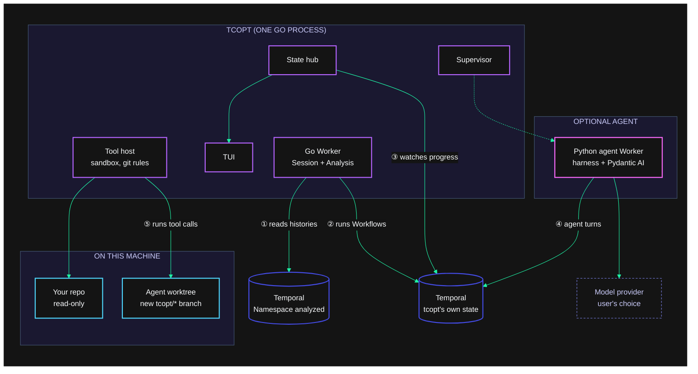
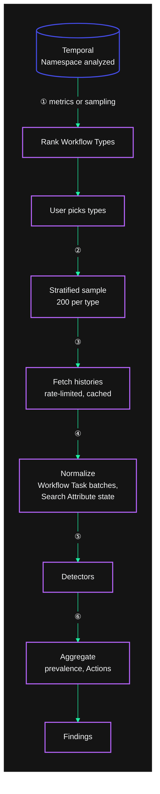
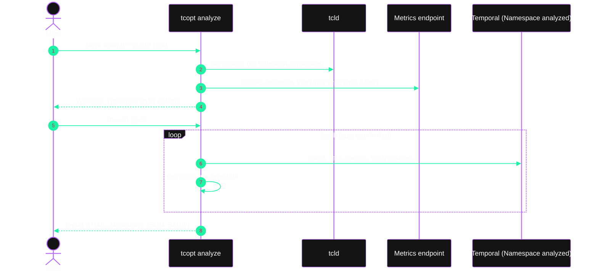
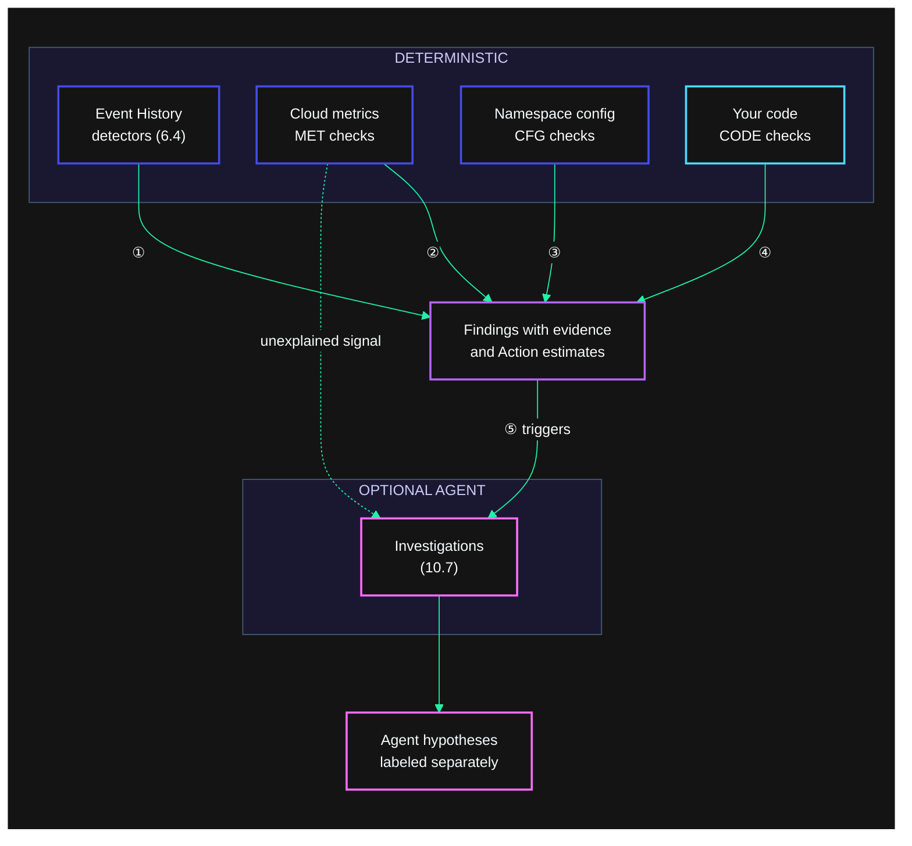
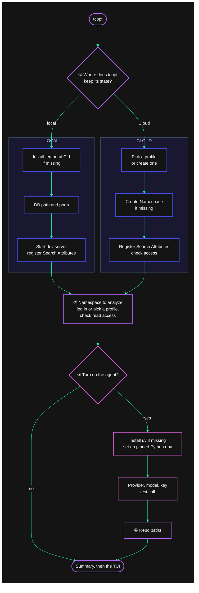
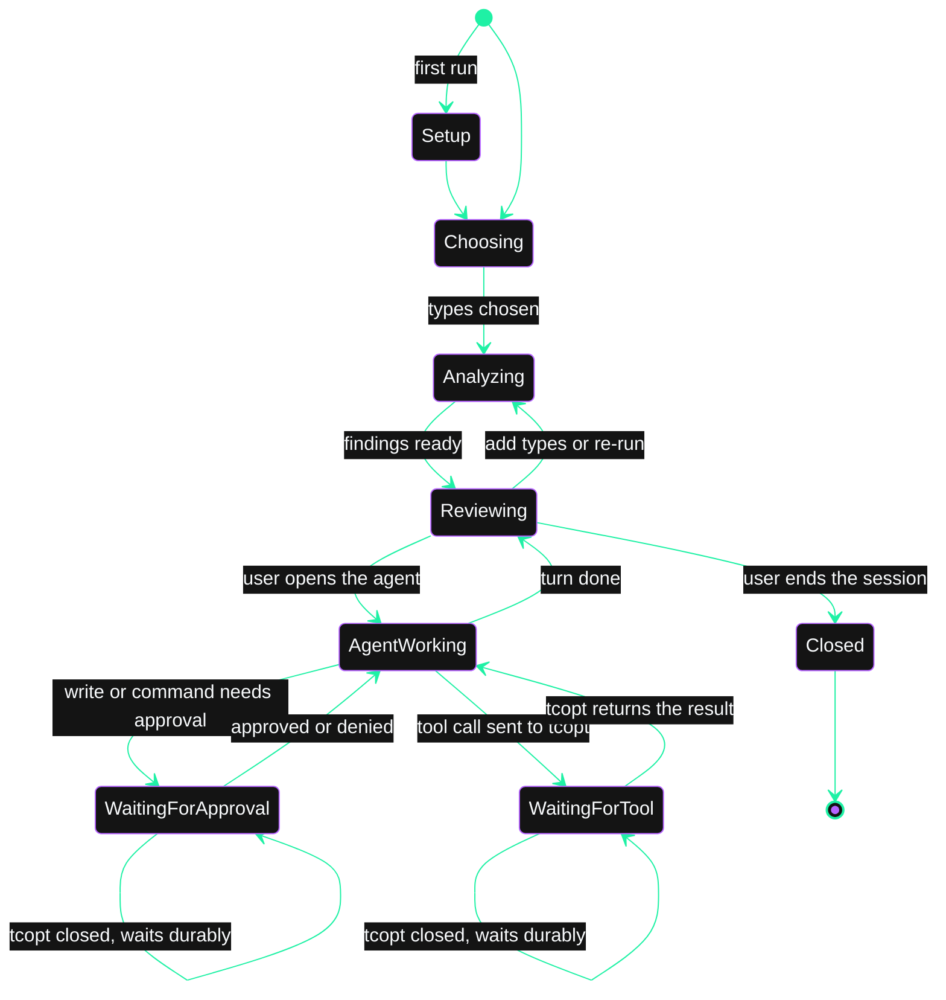
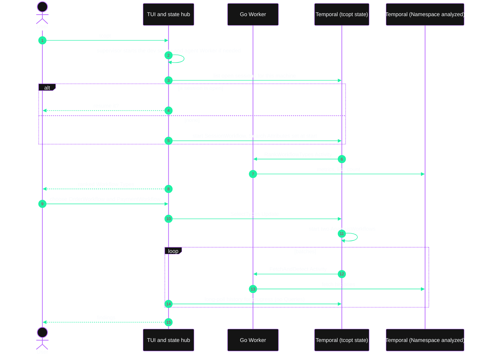
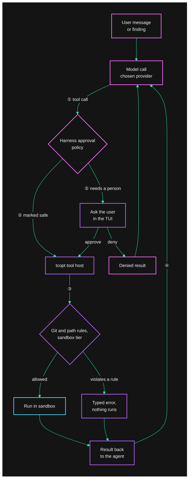
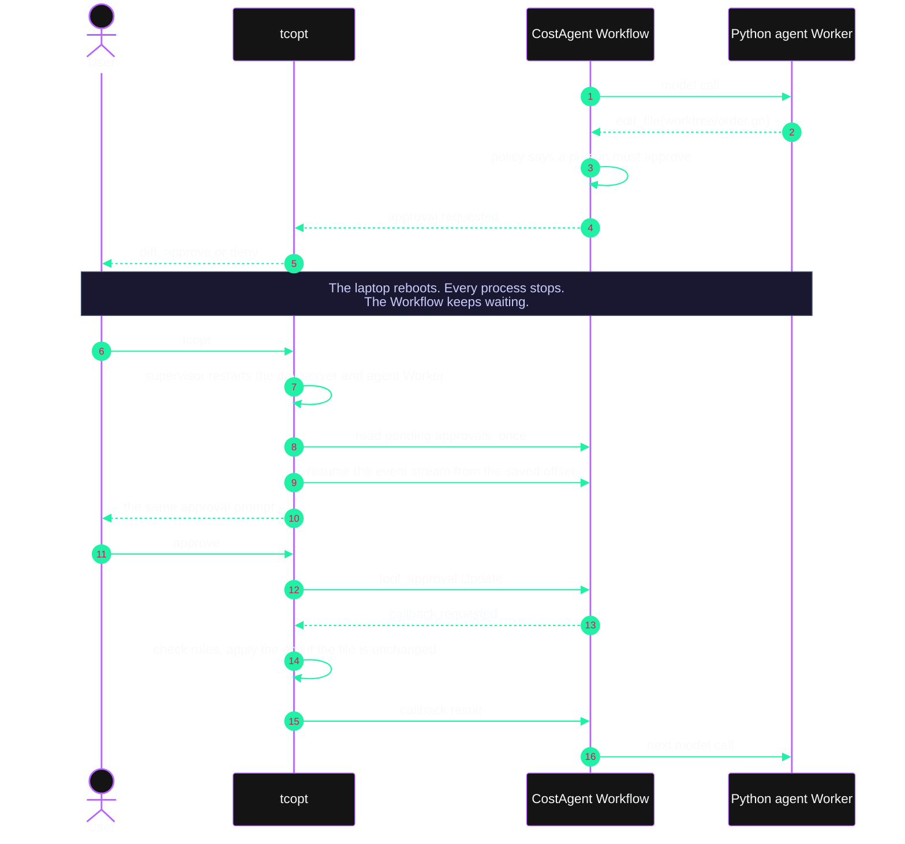

# Temporal cost optimizer: plan and PRD

Status: draft v0.8, 2026-10-15. Owner: Michael Jones. Working name for the binary: `tcopt`.

`tcopt` is a terminal app that reads a Namespace's Workflow histories, finds patterns that waste Temporal Cloud Actions or storage, and shows how much each one costs and how to fix it. It runs on the developer's machine with the Temporal profiles, repos, and toolchains already there. Detection, cost estimates, fix guidance, and code location are deterministic. An optional coding agent can make the fix in a new git worktree, with a person approving each change.

Changes in v0.8:
- The user chooses the model provider: Anthropic, OpenAI, OpenRouter, a LiteLLM proxy, or any OpenAI-compatible endpoint (section 10.6).
- Every cost and saving is measured in Actions, or GB-hours for storage. `tcopt` shows no currency figures and has no price setting.
- Running `tcopt` opens the TUI, and setup happens inside it, including a browser login to Temporal Cloud that creates a short-lived API key (section 8.1). `tcopt` calls the Cloud Ops API itself instead of running `tcld`.

Changes in v0.7:
- Detectors recommend newer Temporal features where they cut cost, such as Standalone Activities and start delays. A feature catalog checks the user's SDK versions (section 6.11).
- The docs index (`llms.txt`) ships with the binary alongside the design-pattern catalog, and the agent can fetch any docs page from it (section 6.7).
- A new playbook has the agent match code to design patterns that cost less (section 10.7).
- `tcopt` never recommends Local Activities as a cost saving (section 6.4).

Changes in v0.6: detection now goes beyond Event History, adding Cloud metrics, Namespace configuration, and static code checks (section 6.9). Storage gets its own detectors and cost estimate (section 6.10). The agent can investigate problems that need judgment (section 10.7). The new patterns come from internal Slack, Notion, Drive, and support tickets, collected in `docs/FIELD-NOTES.md`. Earlier changes:

- v0.5: TUI-only; buildkit writing and diagram rules
- v0.4: embedded knowledge base, billing rules as data, deterministic guidance and code locator
- v0.3: dropped the hosted Worker; adopted the buildkit visual language
- v0.2: agent on temporal-agent-harness; GetVersion resolver versioning; onboarding wizard

---

## 1. Summary

1. The analyzer fetches a sample of Event Histories per Workflow Type and runs detectors over them. For example, it finds three Search Attribute upserts in one Workflow Task that could be one, or Child Workflows that only run one Activity. Each finding cites the Event IDs that prove it and estimates the Actions it would save per month. `tcopt analyze` runs the same analysis headless for scripts and CI.
2. The TUI drives a session that Temporal orchestrates. State lives in a local dev server with a persisted database or in a Cloud Namespace, chosen in a first-run wizard. If the laptop reboots during an analysis or a pending approval, the session resumes where it stopped.
3. Temporal's cost pages and design-pattern catalog ship inside the binary. Each detector has reviewed fix guidance, before-and-after snippets per SDK, and a code locator that lists likely file:line positions. None of this calls an LLM.
4. The optional agent is a Python Worker built on [temporal-agent-harness](https://github.com/temporal-community/temporal-agent-harness). Its tools are harness callback tools, which the Go process runs on the user's machine, inside an OS sandbox. The Go side enforces git rules that no approval can override: the agent only ever writes to a new `tcopt/*` branch in its own worktree. The only new credential is a key for the model provider the user chooses (Anthropic, OpenAI, OpenRouter, or a LiteLLM proxy), kept in the OS keychain.

## 2. Problem

Temporal Cloud bills mainly by Actions, plus Active and Retained Storage. Many expensive patterns come from small coding habits:

- upserting Search Attributes right after start instead of setting them at start
- several upserts in a row where one would do
- unbounded retry policies against third-party APIs
- Child Workflows used where an Activity would do
- Timer-plus-Activity polling loops

These patterns show up in Event History, but finding them means reading thousands of histories and knowing what to look for. Today customers rely on Solutions Architects to do that by hand. Going from a finding to a fix takes more time again: someone has to find the code, understand it, change it, and convince the team it's safe.

Tools that need deployed infrastructure, service accounts, and new API keys tend not to get tried. A developer's laptop already has what this job needs.

## 3. Goals and non-goals

Goals:

- G1. A user points `tcopt` at a Namespace and gets a ranked list of findings, with evidence and estimated monthly savings, in under 10 minutes, using credentials they already have.
- G2. Every finding can be reproduced from the Event IDs it cites. Detection, estimation, guidance, and code location don't use an LLM.
- G3. `tcopt` works fully without the agent: no Python, no LLM key, and no network traffic except to Temporal. CI enforces this (section 5).
- G4. With the agent on, it maps findings to code and edits only a new branch in a new worktree, with a person approving writes.
- G5. Sessions survive closing the terminal, rebooting, and upgrading `tcopt`, including a pending approval.
- G6. Nothing to deploy: one Go binary, plus a `uv`-managed Python environment only if the agent is on.
- G7. A first-run wizard sets up where `tcopt` keeps its own state, which Namespace to analyze, and optionally the agent.
- G8. Results can be shared without hosting anything, as a self-contained HTML report or as Markdown, JSON, or SARIF.

Non-goals for v1:

- A hosted, deployed, or scheduled mode
- Invoice reconciliation. Estimates come from history, and some billable operations never appear there: Queries, Activity Heartbeats, rejected Updates, Export, Schedules, and replication.
- A general-purpose coding agent. The tool set is deliberately narrow.
- Merging or pushing to an existing branch, ever
- Self-hosted cluster infrastructure cost (database, compute)

## 4. Users

| Who | What they want |
|---|---|
| Platform engineer | "Which Workflow Types drive our Actions, and what's wasteful in each, ranked by Actions saved?" |
| App developer | "Show me the line of code for this finding, and give me a branch with the fix to review." |
| Solutions Architect | "Run a cost review with a customer over a screen share, without needing their code." |
| Engineering lead | "Send me the report." It arrives as one HTML file. |

---

## 5. How it fits together

`tcopt` is one Go process. It runs the TUI, a Worker for the analysis Workflows, a state hub that reads Temporal once and feeds the TUI, a supervisor for the local dev server and the agent Worker, and the tool host that runs the agent's tool calls.



1. The Go Worker reads Event Histories from the Namespace being analyzed. It only reads.
2. It runs `tcopt`'s own Session and Analysis Workflows in a separate place: a local dev server or a Cloud Namespace.
3. The state hub follows those Workflows and updates the TUI.
4. If the agent is on, its Workflow runs on the Python Worker, which calls the model.
5. The Go tool host runs every agent tool call, inside the sandbox, against the read-only repo or the agent's worktree.

| | `tcopt analyze` | `tcopt` (TUI) |
|---|---|---|
| Use | CI, scripts, one-off reports | Interactive analysis, the agent, approvals |
| Orchestration | None; runs in-process | Temporal: local dev server or Cloud, chosen in the wizard |
| Agent | No | Optional |
| Needs | Go binary | Go binary, plus `uv` and an LLM key if the agent is on |
| Writes code | Never | Only with the agent, only in a new worktree, with approval |
| Output | HTML, Markdown, JSON, SARIF | The TUI, plus the same exports |

### 5.1 The agent is optional

`tcopt` without the agent is the whole product, minus automated edits and agent investigations. The agent never edits deterministic findings, Action estimates, or guidance. It explains them, finds the code, and with approval changes it. It can also propose new findings from code and metrics (section 10.7). The TUI labels those as agent hypotheses, and they never enter the deterministic totals.

| Capability | Without the agent | With the agent |
|---|---|---|
| Rank Workflow Types, analyze histories, show findings with evidence | Yes | Same; the agent can't change them |
| Estimate Actions | Yes, from billing rules as data (section 6.8) | Same |
| Explain why it costs money and how to fix it | Reviewed guidance, embedded docs, and before-and-after snippets per SDK | Also a conversational explanation that refers to the user's code |
| Find the code | Ranked file:line candidates from the code locator | Also reads around the candidates and picks one |
| Costs history can't show: metrics, Namespace config, code patterns | Yes, MET, CFG, and CODE checks (section 6.9) | Same |
| Problems that need judgment, such as batching or replacing polling Workflows | No | Investigations that produce labeled hypotheses (section 10.7) |
| Make the change | Copy the snippet, or open the file in `$EDITOR` | Edits a new `tcopt/*` worktree, with approvals |
| Runtimes | Go binary, plus the `temporal` CLI for the local backend | Also `uv`-managed Python and an LLM key |

CI keeps it that way:

- The packages for detectors, the estimator, the locator, the knowledge base, and reports may not import the agent client. A `depguard` rule checks this.
- The default end-to-end test runs the wizard, an analysis, guidance, the locator, and an export with the agent off. It fails if a Python process starts or if `tcopt` connects to any host other than Temporal.
- With the agent off, the TUI shows "Enable code assistant (optional)" where agent actions would be. It never shows them as errors.
- With the agent on, Go builds the agent's starting context from the finding, its evidence, the guidance, the matching knowledge-base sections, and the locator's candidates. The model starts from the facts the user sees.

---

## 6. Deterministic analyzer

### 6.1 Data sources

| Need | Source | Notes |
|---|---|---|
| Connect to the Namespace | A browser login to Temporal Cloud (section 8.1), or `go.temporal.io/sdk/contrib/envconfig`, which reads the same TOML profiles and `TEMPORAL_*` variables as the `temporal` CLI | The user picks in the TUI, and the header always shows the login or profile. `tcopt` never falls back to the `default` profile on its own, because it may point at production. |
| Rank Workflow Types by spend | OpenMetrics `temporal_cloud_v1_billable_action_count`, when the user has a metrics key | Best way to choose what to analyze first |
| List Workflow Types without metrics | Sample `ListWorkflowExecutions` over a time window | To confirm: whether Cloud supports `GROUP BY WorkflowType` in count queries |
| Executions per month | `CountWorkflowExecutions` by Workflow Type and start time | Turns savings per execution into monthly totals |
| Retention, replication, export | `tcld namespace get`, or the Cloud Ops API with an API key | Storage findings, and caveats about replicated Actions |
| Actions per execution today | The sampled histories, through the billing rules (section 6.8) | Gives each Workflow Type a baseline, so a type with no findings still shows what it costs |
| Encrypted payloads | The profile's remote codec endpoint | Only detectors that compare values need it. The others work without it. |

Reading history, Describe, List, and Count aren't billable Actions. They do use Namespace requests per second, so the fetcher rate-limits itself. The default is conservative and `--rps` changes it.

### 6.2 Pipeline



1. `tcopt` ranks Workflow Types by billable Actions from metrics, or by execution count from a sample.
2. The user picks one or more types, or all of them.
3. For each type, the sampler picks 200 executions by default, spread across close status, start time, and history length.
4. The fetcher downloads histories, rate-limited, and caches them on disk by `namespace/workflowId/runId`. Closed Workflows stay cached; running ones expire.
5. The normalizer groups commands by the Workflow Task that produced them, tracks Search Attribute values from start through each upsert, reads Activity attempt counts, and links Child Workflow histories when a detector needs them.
6. Detectors run as pure functions. The aggregator reports each finding's prevalence (k of n sampled executions, with a confidence interval) and its estimated Actions saved per month. Each Workflow Type also gets its current Actions per run and per month, from the billing rules.

### 6.3 Finding format

```json
{
  "id": "SA-002",
  "title": "Several Search Attribute upserts in one Workflow Task",
  "workflowType": "OrderWorkflow",
  "confidence": "high",
  "prevalence": { "matched": 187, "sampled": 200 },
  "actionsSavedPerExecution": { "p50": 2, "p95": 4 },
  "projectedMonthly": { "executions": 4100000, "actions": 8200000 },
  "evidence": [
    { "workflowId": "order-123", "runId": "...", "eventIds": [14, 15, 16], "note": "3 upserts in the Workflow Task completed at event 13" }
  ],
  "guidance": "SA-002",
  "locations": [ { "file": "orders/workflow.go", "line": 88, "reason": "UpsertTypedSearchAttributes inside OrderWorkflow; sets OrderStatus" } ]
}
```

Confidence is `high` when history proves the finding, `medium` when it's likely, and `advisory` when fixing it is a tradeoff the user should weigh.

### 6.4 Detectors in v1

The Action counts these detectors rely on come from `kb/billing/actions.yaml` (section 6.8), which cites the embedded Temporal docs.

| ID | Pattern | Evidence in history | Fix | Saving | Confidence |
|---|---|---|---|---|---|
| SA-001 | Search Attributes upserted at the start | An upsert in the first Workflow Task, before any Activity, Timer, or Signal result could affect it | Set them in the start options. Attributes set at start aren't billed. | 1 Action per execution | Medium; the caller may not know the value |
| SA-002 | Several upserts in one Workflow Task | Two or more upsert events from the same `WorkflowTaskCompleted` | One upsert call. A call is one Action however many attributes it sets. | n−1 per Workflow Task | High |
| SA-003 | Upserts in consecutive Workflow Tasks | Upserts with no Signal or Update between them | Set them together at the later point | n−1 | Medium |
| SA-004 | Upsert that doesn't change the value | The new value equals the current one | Compare before upserting | 1 per upsert | High |
| SA-005 | `TemporalChangeVersion` upserts | Created by `GetVersion` | Not billed, so never flagged | 0 | n/a |
| ACT-001 | Retry storm | `ActivityTaskStarted.attempt` above 10 (configurable) | Cap `MaximumAttempts`, raise `InitialInterval`, use `NextRetryDelay`, or pause the Activity | attempt − 10: the retries a cap at 10 would remove | High |
| ACT-002 | Retrying errors that won't succeed | The same failure type and message on every attempt, such as a 4xx, validation, or auth error | Add the type to `NonRetryableErrorTypes` | attempt−1 | Medium |
| ACT-003 | No retry limit on external calls | `maximum_attempts` is 0, no schedule-to-close timeout, and the Activity retried | Set a limit | Risk | Advisory |
| ACT-004 | Heartbeat volume | Heartbeat timeout set on long Activities; estimate is duration ÷ (0.8 × timeout) | Longer timeout, or fewer Heartbeat calls | Estimate | Advisory; Heartbeats aren't in history |
| ACT-005 | Many tiny Activities in a row | k or more sequential Activities with p50 under 50 ms and no branching | Merge them only where per-step visibility and retries don't matter. Never Local Activities (see note below the table). | k−1 per run | Advisory; costs observability |
| LA-001 | Local Activity retries | `nonfirst_local_activity_execution_attempts` above 0. SDKs only meter attempts after the first Workflow Task, so this fires when retries outlast a Workflow Task. | Fix the failure, or use a regular Activity | The metered attempts | High |
| CHD-001 | Child Workflow that runs one Activity | Child history is start, one Activity, complete | Call the Activity directly. Starting a child costs 2 Actions. | 2 per child | High |
| WF-001 | Workflow that only wraps one Activity | One Activity, no Signals, Timers, Updates, Queries handled, or Child Workflows | Start it as a Standalone Activity. The same Activity code runs unchanged; the caller uses the client's Activity start instead of a Workflow start. The locator finds the start call sites. | 1 per execution | High where the SDK supports it (section 6.11) |
| WF-002 | Workflow that waits, then runs one Activity | One leading Timer, then one Activity | Standalone Activity with a start delay | 2 per execution (start and Timer) | High where supported |
| TMR-005 | Workflow whose first command is a Timer | A `TimerStarted` before any other command, with a duration that matches the caller's intent to delay | Workflow start delay | 1 per execution (to confirm, section 6.11) | Medium |
| NEX-001 | Nexus Operation backed by a Workflow that runs one Activity | The handler Workflow's history is start, one Activity, complete | Activity-backed Nexus Operation (Nexus Standalone Activity) | 1 per call | Advisory; pre-release |
| NEX-002 | Workflow that only calls one Nexus Operation | Start, one Nexus Operation, complete, with no other commands | Standalone Nexus Operation started from the client | 1 per execution | Advisory; pre-release |
| TMR-001 | Timer-plus-Activity polling loop | N or more repeats of a Timer followed by the same Activity type | Longer interval; poll with Activity retries (1 Action per poll instead of 2); or one long-running Activity that heartbeats | About half the loop | Medium |
| TMR-002 | Very short Timers | Timer under 1 s | Remove it, or reconsider it | 1 per Timer | High |
| TMR-003 | Timers from waits with a timeout | In at least half the sampled runs, a `TimerStarted` that's canceled, or still pending when the run closed. Go SDK v1.49 doesn't cancel the `AwaitWithTimeout` Timer by default, so most Go histories show the pending case. | Wait without a timeout where the handler doesn't need one, and drain waiters before Continue-As-New | 1 per wait | High |
| TMR-004 | A Timer used to debounce Signals | A Timer starts right after Signals in nearly every execution, though bursts that need debouncing are rare | Buffer Signals in memory and drain them before completing, or batch outside Temporal | 1 per execution | Medium |
| LA-003 | Local Activity outlives the Workflow Task timeout | Consecutive Workflow Tasks that complete with no new commands while a Local Activity runs, or Workflow Task timeouts followed by repeated markers | A regular Activity, or tighter timeouts on the calls inside it | 1 per Workflow Task heartbeat, plus re-run Local Activities | High |
| ACT-006 | Activities rejected by the wrong Worker | Failures saying the Activity type isn't registered, then success on a later attempt | A separate Task Queue per Worker build, or Worker Versioning | attempt−1 | Medium |
| SIG-001 | Bursts of the same Signal | k or more of the same Signal within t ms | Batch on the client | k−1 | Medium |
| SIG-002 | Start, then Signal | A Signal within about 1 s of start, from the same identity | Signal-With-Start: one Action instead of two. Update-With-Start bills the start and the Update separately, so it saves nothing and isn't flagged. | 1 per execution | Medium |
| CAN-001 | Continue-As-New too often | Runs with short, small histories | Continue-As-New less often; each new run is a start | Varies | Medium |
| STO-001 | Large payloads | Inputs, results, or Signals over 256 KB (configurable) | Claim check: pass a reference | Storage | High |
| STO-002 | Retention longer than needed | Retention above the 30-day default with no Export. Nothing tcopt can read shows when people open closed Workflows, so it doesn't claim to know. CFG-005 covers Namespaces with Export on. | Shorter retention | Retained GB-hours × (1 − 30/retention) | Advisory |
| STO-003 | Long-running Workflow without Continue-As-New | Open for days, history still growing, no Continue-As-New in the chain | Continue-As-New at a natural boundary; the old run's history moves to Retained Storage | Active Storage (section 6.10) | High |
| STO-004 | Waiting in Active Storage | Most of the open time is one long Timer or wait, with a large history behind it | Continue-As-New before the wait, or complete and start the next step with a start delay | Active Storage | Medium |
| STO-005 | Finished work kept open by a pending Timer | The last Activity completed long ago, the result is recorded, and a long Timer is still pending | Cancel the Timer when the Signal arrives, or race the two and return | Active Storage | High |
| STO-006 | Local Activity marker overhead | `MarkerRecorded` events make up most of the history's bytes | Shrink Local Activity results; on Java, check whether arguments go into markers (CODE-006); move work that doesn't fit Local Activity use cases to regular Activities | Storage | Medium |
| STO-007 | The same large header in every payload | An identical tracing or security header of 1 KB or more on every Activity input | Trim the header, or store it once | Storage | Medium |

`tcopt` never recommends Local Activities as a way to save Actions. They fit a narrow set of short, latency-sensitive calls, and using them for cost is an anti-pattern: they retry together, give up Worker-level isolation, and can trigger Workflow Task heartbeats. The Local Activity detectors (LA-001, LA-003, STO-006) only flag existing Local Activities that cost more than expected, and their fixes point toward regular Activities.

Each detector has a positive and a negative golden history in `testdata/`, and the Search Attribute detectors have a `TemporalChangeVersion` case.

### 6.5 Headless run



### 6.6 Fix guidance and the code locator

Each detector has a guidance file, `kb/guidance/<id>.md`, that we write and review. Nothing in it is generated. Its front matter drives what the TUI and reports show:

```yaml
id: SA-002
title: Several Search Attribute upserts in one Workflow Task
why_it_costs: Each UpsertSearchAttributes command is one Action, however many attributes it sets.
fix: Collect the attributes and upsert them in one call.
tradeoffs: None. Visibility is the same.
docs:
  - kb: cost/best-practices-cost-optimization#search-attributes
  - kb: cost/evaluate-cloud-actions#workflow
snippets:
  go: guidance/snippets/SA-002.go.md
  java: guidance/snippets/SA-002.java.md
  python: guidance/snippets/SA-002.py.md
  typescript: guidance/snippets/SA-002.ts.md
  dotnet: guidance/snippets/SA-002.cs.md
locator:
  sdk_calls:
    go: ["workflow.UpsertTypedSearchAttributes", "workflow.UpsertSearchAttributes"]
    java: ["Workflow.upsertTypedSearchAttributes"]
    python: ["workflow.upsert_search_attributes"]
    typescript: ["upsertSearchAttributes"]
```

CI compiles the Go snippets against the pinned Go SDK and parses the others with tree-sitter. The build fails if a `kb:` reference doesn't resolve to a page and heading in the embedded knowledge base.

The code locator (`internal/locate`) takes a finding and a repo path and returns ranked file:line candidates, each with the reason it matched:

1. It finds the Workflow definition by its Workflow Type name. For Go it reads the AST for `RegisterWorkflow` and `RegisterWorkflowWithOptions` calls and their `Name` option. For Python, TypeScript, and Java it runs tree-sitter queries for `@workflow.defn(name=…)`, `@WorkflowInterface` and `@WorkflowMethod`, and exported workflow functions.
2. It searches that Workflow, and the functions it calls in the same package or module up to a fixed depth, for the guidance file's `sdk_calls`.
3. It ranks matches using names from the evidence: Activity types, Signal names, Timer durations, and Search Attribute keys. For SA-002 that means `OrderStatus`, `Region`, and `Tier` near the upsert calls.
4. The TUI shows each candidate with a code excerpt, and Enter opens `$EDITOR` at that line. SARIF exports include them as `locations`. With the agent on, they're part of its starting context.

v1 supports Go, Python, TypeScript, and Java, with .NET after that. When the locator finds nothing, it says so.

A later-phase goal is deterministic codemods for a few mechanical fixes, such as merging adjacent `UpsertTypedSearchAttributes` calls in one Go function. An AST rewrite produces the change. It goes through the same tool host as the agent: a new `tcopt/*` worktree and an approved diff.

### 6.7 Embedded knowledge base

Temporal's cost pages and design-pattern catalog are compiled into the binary with `go:embed`, so `tcopt` and the agent never have to look for them and everything works offline. Each page keeps its source URL, so the live version is always one keypress away.

| Collection | Source | Used for |
|---|---|---|
| Cost pages | docs.temporal.io: `evaluate/cloud/actions`, `best-practices/cost-optimization`, `best-practices/managing-aps-limits`, `cloud/actions-usage`, `best-practices/cost-governance`, `cloud/pricing` | Guidance links, checking billing rules, agent context |
| Design-pattern catalog | Every page listed in `docs.temporal.io/design-patterns/llms.txt`, about 50 pages, such as Fixed Count of Retries, Non-Retryable Errors, Continue-As-New, Polling, and Early Return | Guidance links, agent context |
| Docs index | The root `docs.temporal.io/llms.txt` (about 14 KB, indexing roughly 114 pages) and the section indexes it links to, such as `develop/go/llms.txt` and `cloud/llms.txt`. The index only, not the pages. | The agent's map of the docs: it picks a page from the index and fetches it with `docs_fetch` |
| Feature catalog | `kb/features.yaml`, written by us from docs and SDK release notes | Section 6.11 |
| Guidance | `kb/guidance/*.md` and snippets, written by us | Section 6.6 |
| Index | Generated `INDEX.md` and a search index | `tcopt kb`, the agent's `kb_search` tool |

`tools/kbsync` builds it. It's a Go port of the buildkit's `assets/temporal-docs/sync.py`:

- It discovers pages from `llms.txt` plus a fixed list of cost pages, fetches each page's `.md` URL, and removes boilerplate.
- It rewrites links between mirrored pages to local links; other links point at docs.temporal.io.
- It writes front matter on every page: `source_url`, `md_url`, `fetched_at`, `sha256`, `title`, and `summary`.
- It writes `kb/manifest.json` and builds a BM25 search index over headings and paragraphs.

A scheduled CI job runs `kbsync` weekly and opens a pull request with the changes. Someone reviews it, paying most attention to the Actions page (section 6.8). Each release pins one reviewed snapshot.

At runtime:

- `tcopt kb` browses and searches the knowledge base. Every page shows the snapshot date and a key that opens the live page.
- `tcopt kb update` downloads the current pages into `~/.cache/tcopt/kb/` and shows what changed. It's optional and never runs on its own. The refreshed copy is only for reading: billing rules and guidance stay pinned to the release, so a docs change can't change a number on its own. If the live Actions page differs from the snapshot the rules were checked against, the TUI says that estimates may be out of date.
- `tcopt kb export <dir>` writes the snapshot as plain Markdown.
- `tcopt` reports Actions, never currency. The pricing page is embedded for context only, and the TUI links the live page.

The agent reads the knowledge base through two tools, `kb_search(query)` and `kb_read(page, anchor)`, which Go serves from the same files.

For anything outside the embedded pages, the agent uses `docs_fetch(path)`. It looks up the path in the embedded `llms.txt` indexes and fetches the page's `.md` URL. The rules:
- Go makes the request, and only to `https://docs.temporal.io/*.md` paths listed in an index.
- Pages are cached in `~/.cache/tcopt/docs/` and shown in the TUI with their source URL.
- Fetched pages inform the agent's explanations only. Billing rules, guidance, and detectors never read them.
- `tcopt` itself never fetches docs pages. With the agent off, it makes no docs requests at all, which keeps the agent-off network rule in section 5.1.

We don't embed `llms-full.txt`: it's about 7 MB, and the index plus on-demand pages covers the same ground.

### 6.8 Billing rules as data

Detectors and the estimator don't hard-code Action counts. `kb/billing/actions.yaml` maps history events to Actions, and each rule cites the docs section it comes from:

```yaml
snapshot: 2026-10-15
rules:
  - event: EVENT_TYPE_UPSERT_WORKFLOW_SEARCH_ATTRIBUTES
    actions: 1
    exclude_if: { search_attribute_only: TemporalChangeVersion }
    source: cost/evaluate-cloud-actions#workflow
  - event: EVENT_TYPE_START_CHILD_WORKFLOW_EXECUTION_INITIATED
    actions: 2
    source: cost/evaluate-cloud-actions#workflow
  - event: EVENT_TYPE_ACTIVITY_TASK_STARTED
    actions_from: "attempt - 1"   # retries; the first attempt counts at SCHEDULED
    source: cost/evaluate-cloud-actions#activity
  - event: EVENT_TYPE_MARKER_RECORDED
    actions: 1
    per: workflow_task            # Local Activities in one Workflow Task count once
    source: cost/evaluate-cloud-actions#activity
  - operation: signal_with_start
    actions: 1                    # one in total, whether or not it starts the Workflow
    source: cost/evaluate-cloud-actions#signal
not_in_history:
  - { operation: query, actions: 1, source: cost/evaluate-cloud-actions#query }
  - { operation: activity_heartbeat, actions: 1, note: "first call per attempt is sent at once; later calls throttled to 0.8 x HeartbeatTimeout" }
  - { operation: rejected_update, actions: 1, source: cost/evaluate-cloud-actions#update }
  - { operation: schedule_run, actions: 3, source: cost/evaluate-cloud-actions#schedule }
  - { operation: export, actions: 1, per: exported_workflow, source: cost/evaluate-cloud-actions#export }
namespace_multipliers:
  - { setting: replication, actions: 2.0, storage: 2.0, note: "the billable_action_count metric reports 1x" }
  - { setting: fairness, actions: 1.1, per: hour_enabled, source: cost/evaluate-cloud-actions#fairness }
  - { setting: provisioned_capacity, floor: hourly_per_tru, source: cost/evaluate-cloud-actions#capacity }
```

A test checks each rule against its cited section in the pinned snapshot. For example, it checks that the Child Workflow section still says two Actions. When a `kbsync` pull request changes the Actions page, these tests fail, and someone updates the rules and the snapshot date together. The TUI and reports label everything in `not_in_history` as excluded or estimated.

### 6.9 Costs that Event History can't show

Some of the largest items on a bill never appear in a Workflow's history:
- Queries, Heartbeats, and rejected Updates
- Schedules and Export
- replication, Fairness, and Provisioned Capacity

Internal reports from Slack, Notion, Drive, and support tickets (`docs/FIELD-NOTES.md`) show these often matter as much as anything in history. `tcopt` checks three more sources for them, all deterministic. Each check has an ID, a guidance file, and tests, like the history detectors.



1. History detectors find what each execution's events prove.
2. Metric checks find Action types that history doesn't record.
3. Configuration checks find Namespace settings that multiply cost.
4. Code checks find patterns in the user's repo with AST and tree-sitter rules, without a model.
5. With the agent on, findings and unexplained metric signals start investigations. Their results show as hypotheses, separate from deterministic findings.

**Cloud metrics.** These checks need an OpenMetrics API key from a Service Account with the account-level Metrics Read-Only role; only an Account Owner or Global Admin can create one. They read `temporal_cloud_v1_billable_action_count`, broken down by Workflow Type and Action type, from `https://metrics.temporal.io/v1/metrics`. The endpoint returns only the latest completed one-minute window, about 3 minutes behind, and allows 180 requests an hour. So on its own, `tcopt` scrapes three windows and projects from them, with a caveat. MET-005 and MET-006 need days of data, so they only run when the user also gives a Prometheus-compatible server that stores the scrapes.

| ID | Pattern | Signal | Fix |
|---|---|---|---|
| MET-001 | Heartbeat-heavy Workflow Type | Heartbeat Actions per Activity above 1 | Longer HeartbeatTimeout; no Heartbeats in short Activities; delay the first Heartbeat, which every SDK sends immediately |
| MET-002 | Query polling | Query Actions per open Workflow per hour above a threshold | Read status with Describe, memo, or Search Attributes, once, and share it |
| MET-003 | Rejected or redundant Updates | Update Actions well above the accepted Updates in history | Validate before sending; don't rely on Update validators to deduplicate |
| MET-004 | Action mix out of line with the design | One Action type's share well above what the sampled histories explain, such as Activity Actions far above Activity completions | Points to retry storms (ACT-001) or rejected tasks (ACT-006) |
| MET-005 | Design change between two windows | Activities and Timers per start change together after a deploy | Confirms a polling loop was added or removed |
| MET-006 | Usage spike | Daily Actions above twice the 7-day average, per Namespace or Workflow Type | Alert, and check non-production Namespaces first |

The metric is an estimate. It leaves out Export, Fairness, and Provisioned Capacity, and it reports replicated Namespaces at 1x although the invoice is 2x. When the user has Billing API access, `tcopt` treats the Billing API as the source of truth.

**Namespace and account configuration.** These checks read from `tcld` or the Cloud Ops API.

| ID | Pattern | Signal | Fix |
|---|---|---|---|
| CFG-001 | Replication on a non-production Namespace | A replica on a Namespace named or tagged dev, test, or staging | Remove the replica. Replication doubles Actions and storage. |
| CFG-003 | Fairness on but unused | Fairness enabled, and no fairness keys seen in history | Turn it off. It adds 0.1 Action per Action for each hour it's on. |
| CFG-004 | Provisioned Capacity above use | TRUs compared with consumed and throttled Actions. Each TRU after the first has an hourly floor. | Lower TRUs or return to on-demand; raise them only around known spikes |
| CFG-005 | Export with full retention | Export on, retention unchanged | Shorten retention. Export costs 1 Action per Workflow and doesn't lower storage by itself. |
| CFG-006 | Idle Namespace | No starts in N days, storage still billed | Delete it. Lowering retention only affects Workflows that close later. |
| CFG-007 | Frequent or one-shot Schedules | Schedules with short intervals, or `RemainingActions` of 1 used as a delayed start | Each run costs 3 Actions. Use a start delay, or a Workflow that sleeps. |
| CFG-008 | Schedule storage | Open Schedules with large histories (Visibility query on `TemporalNamespaceDivision="TemporalScheduler"`), or spec size growing over time | Delete unused Schedules; replace the full spec on update (CODE-005) |
| CFG-010 | A Schedule that starts a one-Activity Workflow | The Schedule's target Workflow Type matches WF-001 | Schedules can't start Standalone Activities yet (planned). Until then, `tcopt` flags these so the user can switch when the feature ships, or start a Standalone Activity with a start delay from their own code if that fits. Advisory. |

`tcopt` doesn't judge which Workflow Types need replication, because nothing it can read says which ones are critical. For a replicated Namespace it reports what replication costs per Workflow Type, as information rather than a finding, and leaves the decision to the user.

**Static code checks.** The code locator's engine runs these rules over the user's repo. Each rule is a Go AST or tree-sitter query in `kb/checks/<id>.yaml`, with positive and negative fixtures, and reports file:line.

| ID | Pattern | Rule |
|---|---|---|
| CODE-001 | Query polling in client code | A Query call inside a loop, ticker, or HTTP handler |
| CODE-002 | Waits with a timeout in Update or Signal handlers | `AwaitWithTimeout`, `condition(..., timeout)`, and equivalents inside handlers (pairs with TMR-003) |
| CODE-003 | Heartbeat settings that drive volume | Short `HeartbeatTimeout`; a Heartbeat as the first statement of an Activity |
| CODE-004 | Encryption without compression | A payload codec chain that encrypts with no compression step before it. Storage is billed on the bytes the client sends. |
| CODE-005 | Schedule updates that grow the spec | A Schedule update that sets only cron expressions |
| CODE-006 | Java Local Activity arguments in markers | Local Activity options without `setDoNotIncludeArgumentsIntoMarker(true)` (default behavior to confirm) |
| CODE-007 | Start, then Signal or Update | A start followed by a Signal or Update to the same Workflow ID in the same function |
| CODE-008 | SDK versions with known cost bugs | A lockfile pinning a version on the known-issues list, such as Core-based SDKs that sent an extra final Heartbeat (exact versions to confirm) |
| CODE-009 | No retry limit on external calls | Activity options without `MaximumAttempts` on Activities whose names or imports point at HTTP clients |
| CODE-010 | Status read with a Query where Describe works | A Query whose handler only returns status that a Search Attribute or memo already holds |

### 6.10 Storage cost

Storage is billed per GB-hour, and the pinned pricing page puts Active Storage at about 40 times the rate of Retained Storage. So an open Workflow's history costs far more per hour than a closed one's.

For each Workflow Type, `tcopt` estimates:

- Active GB-hours: open executions (Count) × their history size (Describe) × open hours (from the sample's open-duration distribution)
- Retained GB-hours: closed executions per month × average history size × retention hours

Storage findings (STO-001 to STO-007, CFG-005, CFG-006, CFG-008) report GB-hours saved per month, Active and Retained separately, in their own column next to Actions. `tcopt` doesn't convert either into currency. The estimate notes what it can't see: replication doubles storage, and Schedules and batch jobs run system Workflows whose histories also count. When the Billing API is available, `tcopt` compares its estimate with the billed storage. A large gap usually points at those system Workflows.

### 6.11 Newer features that cut cost

Several findings are cheapest to fix with a feature that didn't exist when the code was written. For example, a Workflow that only wraps one Activity costs 2 Actions per run, and a Standalone Activity costs 1. Standalone Activities are GA in Temporal Cloud and in the Go (v1.49), Python (1.33), and .NET (1.19) SDKs. `tcopt` recommends a feature only when the user can actually use it.

`kb/features.yaml` lists each feature that a detector may recommend:

```yaml
- id: standalone-activity
  docs: standalone-activity                 # embedded or fetchable docs page
  cloud: ga
  sdks:
    go:     { stage: ga, min: "1.49.0" }
    python: { stage: ga, min: "1.33.0" }
    dotnet: { stage: ga, min: "1.19.0" }
    java:   { stage: public-preview, min: "1.36.0" }   # to confirm before release
    typescript: { stage: unknown }                       # to confirm
  saves: "1 Action per execution compared with a one-Activity Workflow"
  used_by: [WF-001, WF-002, CFG-010]
- id: standalone-activity-start-delay
  cloud: ga
  used_by: [WF-002, CFG-007]
- id: workflow-start-delay
  used_by: [TMR-005, CFG-007]
- id: update-with-start
  used_by: [SIG-002]
- id: next-retry-delay
  used_by: [ACT-001, ACT-002]
- id: activity-pause
  used_by: [ACT-001]                        # pause and fix instead of retrying forever
- id: nexus-standalone-activity
  cloud: pre-release
  used_by: [NEX-001]
- id: standalone-nexus-operation
  cloud: pre-release
  used_by: [NEX-002]
```

How detectors use it:

1. The code locator already reads the repo's lockfiles (`go.mod`, `requirements.txt` or `uv.lock`, `package-lock.json`, `pom.xml` or `build.gradle`, `*.csproj`). It reports each Temporal SDK and its version.
2. When a finding's fix needs a feature, the finding shows the feature's stage and whether the user's SDK version has it:
   - "Available in your Go SDK (v1.52.0)", or
   - "Needs Go SDK v1.49.0 or later; you have v1.44.0", or
   - "Pre-release; not recommended for production".
3. Findings whose only fix is a pre-release feature are advisory and hidden unless the user passes `--include-preview` or turns it on in the TUI.
4. With no repo configured, the finding lists the minimum version for each SDK.

The feature catalog is reviewed with each `tcopt` release. When `kbsync` sees a docs page change its release-stage banner, CI fails until someone updates `features.yaml`. SDK release notes are checked by hand, because they aren't part of the docs index.

Open points to confirm: Java and TypeScript stages for Standalone Activities, whether a Workflow start delay is billed differently from a leading Timer (TMR-005's saving depends on it), and when Schedules can start Standalone Activities directly (CFG-010).

---

## 7. Visual design

The TUI uses the visual language of `temporal-toolkit-demo-buildkit` (guides 02, 03, and 04, and `assets/css/temporal-theme.css`). Most of it carries over to a terminal: the palette, what each color means, square flat panels, mono uppercase labels, badges, and the UX rules. The terminal controls fonts and has no blur, so those parts don't carry over. The buildkit's Temporal k9s skin already shows a full terminal app in these colors.

### 7.1 Theme

`internal/theme` holds the buildkit tokens (`#141414` space black, `#444ce7` ultraviolet, `#6169ed` hover, `#cacbf9` indigo-100, `#1ff1a5` green, `#fecb2f` yellow, `#ff6bff` pink, `#92a4c3` slate, `#243349` border, `#ff5555` red) as Lip Gloss colors. `tcopt` detects the terminal's color support and falls back from truecolor to 256 colors to 16. `NO_COLOR` gives monochrome with text labels.

| Buildkit element | In the TUI |
|---|---|
| Color meaning: green for live or healthy, yellow for in progress, pink for a special event, slate for idle, red only for real errors | The same. Findings aren't errors: high confidence is green, medium is yellow, advisory is slate. Agent hypotheses carry an indigo `[AGENT]` badge. A pending approval is the one pink element on screen. Red is only for failed calls, rule violations, and stopped Workers. |
| Dark hero gradient | Only the header band gets an ultraviolet-to-black gradient. `tcopt` doesn't repaint the rest of the user's terminal unless they pass `--theme=full`. |
| Manrope and Noto Sans Mono | The terminal font is the user's. Hierarchy comes from color, bold, and uppercase labels. The buildkit already sets labels and numbers in mono. |
| Gradient text | Per-character color on the title and the savings figure only, at 256 colors or more |
| Square buttons and flat cards | `lipgloss.NormalBorder()` with square corners, border `#243349`. The focused panel's border is green, the buildkit's focus color. No rounded corners or shadows. |
| Pills | Green background with black uppercase text, such as ` ANALYZING ` |
| Badges | `[HIGH]`, `[MEDIUM]`, `[ADVISORY]` in their color, always with the word |
| Eyebrow line | `TEMPORAL COST OPTIMIZER · PROFILE prod · NS orders.a1b2c` in indigo-100. The header always shows the profile and Namespace. |
| Starfield | Dots and braille in the header band at about 8 frames a second. They drift faster while histories download. `m` pauses motion. Motion is off with `--reduced-motion`, `TCOPT_REDUCED_MOTION=1`, over SSH, and when output isn't a terminal. |
| Ziggy as a status character | Shown as an image in terminals that support Kitty graphics, iTerm2 inline images, or Sixel, and as half-block characters elsewhere. Pending brand approval (section 14). |
| Charts | Sparklines and bars in block characters, labeled directly, on fixed scales |

### 7.2 Overview screen

```text
┌──────────────────────────────────────────────────────────────────────────────┐
│ ✦ ·   TEMPORAL COST OPTIMIZER · PROFILE prod · NS orders.a1b2c      ·  ✧   · │
│   Est. savings  24.8M Actions / month                      [ANALYZING] 14/20 │
├───────────────────────────────────────────┬──────────────────────────────────┤
│ WORKFLOW TYPES  ACT/MONTH  SAVES/MONTH    │           ▄▄▄▄                   │
│ OrderWorkflow         41M         8.2M    │         ▄██████▄   "Found 3 extra│
│ PaymentWorkflow       33M         7.6M    │         ██▀██▀██    upserts per  │
│ ShipmentWorkflow      19M         4.4M    │          ▀████▀     order: about │
│ NotifyWorkflow       900K  no findings    │                  8.2M Actions a  │
│                                           │                  month"          │
├───────────────────────────────────────────┴──────────────────────────────────┤
│ SA-002 · Several upserts in one Workflow Task            187 of 200 sampled  │
│ Events 14, 15, 16 · fix: one upsert call · orders/workflow.go:88             │
├──────────────────────────────────────────────────────────────────────────────┤
│ ↑↓ select  ⏎ open  l locate  k docs  a agent  e export  m motion  ? help  q  │
└──────────────────────────────────────────────────────────────────────────────┘
```

### 7.3 Ziggy's lines

Ziggy's line has to match what's on screen.

| Session state | Ziggy | Example line |
|---|---|---|
| Idle | Slow bob | "Pick a Workflow Type to inspect." |
| Fetching histories | Faster bob, green glow | "Scanning histories: 1,420 of 4,000." |
| Findings ready | Steady, green glow | "Found 3 extra upserts per order: about 8.2M Actions a month." |
| Waiting for approval | Pink glow | "Waiting on you: approve the edit to order.go?" |
| Agent Worker offline | Still, partly gray | "The agent Worker is offline. Your approval is saved." |
| Error | Unchanged; the error shows as a red line | "Couldn't reach the Namespace. Retrying in 10 s." |

### 7.4 UX rules

These come from buildkit guide 04:

- Each screen has one main element: the estimated savings on the overview, and the evidence on a finding.
- Every keypress gets a visible response within 100 ms. The TUI shows that an action was accepted ("Analysis started") separately from its outcome ("14 of 20 types done").
- Every number says what it counts and over what window, such as "per execution, p50, 200 sampled, last 7 days". Estimates are labeled as estimates. Zero, loading, unavailable, and stale data look different from each other.
- Key hints are always visible in the footer.
- Colors meet WCAG 2.2 AA contrast on the buildkit palette, color never carries meaning alone, and everything works from the keyboard.
- Following buildkit guide 16, the TUI never polls a Query. The state hub reads history with long polling and Describe, which aren't Actions, and queries once when it attaches to a session.

---

## 8. First-run wizard

Running `tcopt` opens the TUI, the way `claude` opens Claude Code. The first time, or when nothing saved still works, the TUI walks through four steps before the overview. Every step happens on a TUI screen: the user never has to run `tcld`, `temporal`, or a `tcopt` subcommand to finish setup. Settings go to `~/.config/tcopt/config.toml`. Secrets go to the OS keychain or stay in the user's existing `temporal.toml` profile.



1. The user chooses where `tcopt` keeps its own state. The local option installs the `temporal` CLI if it's missing and starts a supervised dev server with a persisted database at `~/.tcopt/temporal.db`. The Cloud option uses the login from section 8.1 or an existing profile, and can create a dedicated Namespace through the Cloud Ops API.
2. The user picks the Namespace to analyze: log in to Temporal Cloud and pick from the Namespaces they can see, choose a profile from `temporal.toml`, or use `TEMPORAL_*` variables. `tcopt` checks it can list executions there.
3. Optionally, the user turns on the agent. `tcopt` installs `uv` if needed, sets up the pinned Python environment, asks for a provider and model (section 10.6), stores the key in the keychain, and makes one small test call.
4. Optionally, the user adds repo paths and a base branch.

Rules:

- The user can skip any step and return to it from the TUI. In the overview, `n` goes back to choosing a Namespace.
- `--profile`, `TEMPORAL_PROFILE`, or `TEMPORAL_ADDRESS` skip step 2 for that run. `tcopt analyze` uses the saved target when none of them is set.
- Before installing software or creating a Namespace or Search Attributes, `tcopt` shows the exact command and asks for confirmation.
- Validation uses DescribeNamespace and a Worker poll check. It never starts a Workflow, so setup costs no Actions.
- With the Cloud option, the wizard suggests a Namespace dedicated to `tcopt` and estimates the Actions the agent would use (section 10.5).

### 8.1 Logging in to Temporal Cloud

Namespace endpoints accept an API key or mTLS, not a browser login. So `tcopt` logs in the way `tcld` does, then uses that login to create an API key it can read histories with:

1. The TUI asks `login.tmprl.cloud` for a device code (OAuth device flow), opens the approval page in the browser, and shows the code so the user can check it matches. The URL is on screen too, in case no browser opens. `tcopt` only opens pages on the login domain.
2. When the user approves, `tcopt` keeps the login token, including its refresh token, in the OS keychain.
3. With that token it calls the public Cloud Ops API (`go.temporal.io/cloud-sdk`) as the user: `GetCurrentIdentity`, then `GetNamespaces`. The TUI lists the Namespaces with a type-to-filter box. Namespaces that only accept mTLS are shown but can't be picked.
4. The TUI shows the key it's about to create: its name (`tcopt-<host>`), the owner, the Namespace, and an expiry 7 days out. The key has the user's own permissions. Nothing is created until the user presses Enter.
5. `tcopt` creates the key, stores it in the keychain, and saves the target in `config.toml` without the secret. A new key can take about a minute to reach the Namespace, so the TUI retries a read-only list call and shows its progress.
6. Next time, `tcopt` reconnects straight to the overview. When the key has expired or been revoked, the TUI goes to the confirmation in step 4 for the same Namespace, reusing the stored login if it can still be refreshed.

`tcopt` doesn't delete keys it created. They expire on their own.

---

## 9. Sessions

### 9.1 Workflows

| Workflow | Runs on | Lifetime | Holds |
|---|---|---|---|
| `SessionWorkflow` | Go Worker | Hours to weeks; Continue-As-New at set points | Settings, chosen types, the findings index, agent session IDs. ID: `tcopt-session-{machineId}-{ulid}` |
| `AnalysisWorkflow` | Go Worker | Minutes | One per Workflow Type. Runs `FetchAndDetect` Activities over batches of histories. |
| `CostAgent` | Python agent Worker | One conversation; waits between messages | The agent's turn loop |

Workers use Task Queues scoped to the machine, `tcopt-{machineId}` and `tcopt-agent-{machineId}`, so no other machine picks up the work. The machine ID is stored in `~/.tcopt/`.

The target Namespace and `tcopt`'s own state are always separate. `tcopt` only reads the target Namespace.

Go Workflows encrypt payloads with AES-GCM, using a key from the OS keychain. The agent uses the harness's data converter, which stores large payloads on the local filesystem; adding encryption there is open (section 14). Secrets never go into Workflow inputs or history. The supervisor passes the LLM key to the Python Worker's environment from the keychain.

### 9.2 Session states



### 9.3 Starting a session



---

## 10. Agent

### 10.1 Why temporal-agent-harness

[temporal-agent-harness](https://github.com/temporal-community/temporal-agent-harness) is an experimental, pre-1.0 Python library from Temporal. It provides:

- turns that resume mid-turn after a crash
- a tool approval policy with auto-approval for tools marked safe, allow-lists, "approve and stop asking", and runtime changes
- a stream of agent events that a client can replay from an offset
- callback tools: the Workflow pauses, a client on the user's machine runs the tool, and the harness checks the result's type before the turn continues

Its `examples/callback_tools/coding_agent` example has the same shape we need.

Go stays the main codebase. The agent runs as its own Python Worker, `tcopt-agent`, and `tcopt` acts as its callback client and tool host. Users who don't turn on the agent never need Python.

### 10.2 Turns and tool calls



1. The model asks for a tool.
2. The harness policy either approves it automatically, because the tool is marked safe or allow-listed, or asks the user in the TUI.
3. `tcopt` checks its own rules before running anything. An approval can't override them.
4. The result, or the refusal, goes back to the model.

### 10.3 Tools

Every tool is a callback tool. The Python side declares its typed signature, and Go implements it. A code generator builds the Go structs from the JSON Schema the agent advertises, and CI fails if they don't match.

| Tier | Tools | Approval | What `tcopt` enforces |
|---|---|---|---|
| 0, read | `list_findings`, `get_finding_evidence`, `get_history_excerpt`, `get_guidance`, `locate_code`, `kb_search`, `kb_read`, `docs_fetch`, `describe_namespace`, `list_schedules`, `count_workflows`, `metric_series`, `read_file`, `list_dir`, `grep`, `glob`, `git_log`, `git_show`, `git_diff` | Automatic; marked safe | Repo root and analysis data only; never `~/.ssh`, `.env*`, or keychains. The Temporal tools never send a Query to a Workflow. |
| 1, writes | `create_worktree`, `write_file`, `edit_file`, `git_commit` | Asks; "approve and stop asking" allowed for edits in the agent's worktree | New `tcopt/*` branch only; paths inside the worktree; `HEAD` checked before every write |
| 2, commands | `run_command` | Asks; the user can allow a command prefix for the session | Sandbox with no network, writable only in the worktree and a temp directory; CPU and time limits |
| 3, leave the sandbox | `request_escalation(command, reason, scope)` | Always asks; `tcopt` refuses "stop asking" | Runs the exact argv shown, once or for an approved prefix |
| 4, remote | `git_push`, `open_pr` (draft) | Always asks; never remembered | `refs/heads/tcopt/*` only, never forced; uses the user's existing git and `gh` login |

Git rules the tool host enforces:

1. The agent never runs raw git. Each git operation is its own tool with validated arguments.
2. `create_worktree` only creates a new branch named `tcopt/<session>/<slug>`, which must not exist locally or on any remote. It branches from a ref the user chose, by default the default branch's `HEAD`.
3. Paths are resolved with `filepath.EvalSymlinks` and must sit inside the worktree.
4. Before every write or commit, `git symbolic-ref HEAD` in the worktree must equal the agent's branch.
5. Commits run with `core.hooksPath=/dev/null`, so the repo's hooks never run outside the sandbox.
6. The sandbox mounts the main checkout read-only.
7. Pushes go only to `refs/heads/tcopt/*`, without force, after checking that the ref is new or already ours.

Sandboxing uses a Seatbelt profile through `sandbox-exec` on macOS and `bubblewrap` with landlock on Linux. On Windows, v1 asks before every command and has no sandbox.

Repo files, docs, and history payloads are untrusted input to the model. The approval policy and the git rules never consult the model. Approval prompts show the exact argv, path, and diff. The harness's model-judged auto mode stays off.

### 10.4 Resuming after a reboot



### 10.5 Connecting `tcopt` to the harness

The harness talks to clients through Temporal: an Update for approvals, Workflow Streams for events (Signals to publish, Updates to long-poll, a Query for the offset), Queries for status, and a callback-result call.

To start, `tcopt`'s supervisor runs the harness's packaged server and session manager on loopback, and Go calls its HTTP endpoints (`/api/sessions`, `/api/chat`, `/api/approve`, `/api/callback-result`). The harness's own coding example connects the same way. A Go `AgentBackend` interface hides this, so we can switch to calling Temporal directly once the harness protocol settles.

Stream publishes are Signals and long-polls are Updates, and both are billable on Cloud. The state hub subscribes once per session. We'll set a longer flush interval, about 500 ms, and measure Actions per agent turn in Phase 3. On the local backend these Actions cost nothing.

### 10.6 Models

The user brings their own model. The agent calls it through the harness's Pydantic AI integration, which has a provider for each option, so `tcopt` needs no client code of its own:

| Provider | Pydantic AI provider | What the wizard asks for |
|---|---|---|
| Anthropic | `anthropic` | API key |
| OpenAI | `openai` | API key |
| OpenRouter | `openrouter` | API key |
| LiteLLM proxy | `litellm` | Proxy URL and key; the proxy routes to whatever the team has configured |
| OpenAI-compatible endpoint, such as Azure OpenAI, vLLM, or Ollama | `openai` with a base URL | Base URL and key, if the endpoint needs one |

The wizard stores the choice in `~/.config/tcopt/config.toml` and the key in the OS keychain. `tcopt setup agent` changes it later. The agent uses two model slots: one for planning and edits, and a smaller one for summarizing histories. With Anthropic the defaults are `claude-opus-5-5` and a Haiku model. With other providers the wizard lists the provider's models and the user picks both. It doesn't guess.

The test call during setup checks that the model supports tool calling, because every agent tool is a tool call. A model that fails the check is refused with a message that says why.

The Python Worker only connects to Temporal and to the chosen provider's endpoint. The TUI shows the provider and model in the agent panel, and tokens used per turn. An optional session budget pauses the agent behind an approval when it runs out. Token cost per provider isn't estimated; the TUI shows token counts only.

### 10.7 Investigations

Some problems need judgment that rules can't supply. For example:

- one Workflow per low-value item, where batching would cut Actions by an order of magnitude but costs per-item visibility
- a fleet of polling Workflows that a single Signal-driven Workflow or a database sweeper could replace
- Update-based concurrency slots, or a parent fanning out thousands of children
- a heartbeat-heavy metric (MET-001) where the cause is somewhere in the code

The agent handles these as investigations.

One playbook, `pattern-fit`, asks the agent to match the user's code to a cheaper design pattern. The embedded catalog groups patterns into categories, and each category page has a decision tree, which gives the agent a structured way to choose. Examples:

| What the agent sees | Pattern it may suggest |
|---|---|
| A Workflow that loops on a Timer to poll an external system | Polling (frequent and infrequent variants), or a long-running Activity that heartbeats |
| One Workflow per small item | Batch Iterator or Sliding Window |
| A long-lived Workflow whose history grows | Entity Workflow with Continue-As-New |
| A Timer that gets reset by every Signal | Updatable / Debounced Timer |
| Retries against a paid or rate-limited API | Fixed Count of Retries, Delayed Retry, or Resumable Activity |
| A start followed by an Update to get a quick answer | Early Return (Update-With-Start) |

The suggestion is a hypothesis like any other. It cites the code, the pattern's page in the knowledge base, and the parameters Go needs to estimate the saving. When a pattern depends on a newer feature, the feature catalog's check applies, so the agent can't recommend something the user's SDK doesn't support. The playbook excludes Local Activities as a cost fix.

Each investigation follows a playbook in `kb/playbooks/<id>.md`. A playbook names:
- the deterministic signal that starts it, such as a MET or CFG check or a finding
- what the agent should read: the Workflow and Activity code, Schedule definitions, and client code that sends Queries or Updates
- the questions to answer
- the evidence a result must cite

The user starts an investigation from a finding or a metric signal in the TUI. `tcopt` never starts one on its own.

The agent gets a few read-only Temporal tools for this. Go serves them, and none sends a Query to a Workflow:
- `describe_namespace` and `list_schedules`
- `count_workflows(query)`
- `metric_series(name, labels, window)`

The result is a hypothesis in a fixed format:

```json
{
  "id": "HYP-7",
  "playbook": "per-item-workflows",
  "claim": "PaymentReminderWorkflow starts once per invoice line; batching 100 lines per Workflow would remove 99 starts and 99 x 4 Activities per batch.",
  "evidence": [
    { "kind": "code", "file": "billing/reminders.go", "line": 42 },
    { "kind": "metric", "series": "billable_action_count{workflow_type=PaymentReminderWorkflow}", "window": "7d" }
  ],
  "parameters": { "batch_size": 100, "actions_per_item": 5 },
  "tradeoffs": "Loses per-item retries and visibility; partial failures need handling.",
  "guidance": ["kb:design-patterns/batch-iterator"]
}
```

The agent supplies parameters and evidence. Go computes the Action estimate from them with the same estimator the deterministic findings use, so the agent never states a number of its own. Hypotheses show with their own badge, `[AGENT]` in indigo. The user can accept one, which makes it a tracked item, or discard it. Accepted hypotheses can lead to a worktree change through the same approvals and git rules as any other edit. They stay out of the deterministic totals and out of `tcopt analyze` output.

---

## 11. Versioning Workflow changes

`tcopt` follows [mikeacjones/temporal-example-versioning-go](https://github.com/mikeacjones/temporal-example-versioning-go). Each Workflow calls `GetVersion` once, at the top, and dispatches to a frozen implementation for that version. Workers don't use Worker Versioning, and Workflow bodies contain no other `GetVersion` calls.

```text
internal/workflows/session/
  session.go             # SessionWorkflow: shared handlers, then resolveFlowVersion
  structs.go             # Input (with VERSION), State, Result, the session interface
  sessionWorkflow.go     # current version; edit this file
  sessionWorkflow_v1.go  # frozen
  sessionWorkflow_v2.go  # frozen
```

```go
const flowChangeID = "workflow/session"
const MIN_VERSION = 1

func SessionWorkflow(ctx workflow.Context, input SessionInput) (SessionResult, error) {
    state := &SessionState{}
    ctx = workflow.WithValue(ctx, stateKey, state)
    // Register Signal and Update handlers here, once, for every version.
    return resolveFlowVersion(ctx, input.VERSION).run(ctx, input)
}

func resolveFlowVersion(ctx workflow.Context, v workflow.Version) session {
    if v <= 0 {
        v = workflow.GetVersion(ctx, flowChangeID, MIN_VERSION, sessionVersionCurrent)
    } else {
        workflow.GetVersion(ctx, flowChangeID, v, v) // pinned: still records the marker
    }
    switch v {
    case sessionVersionCurrent:
        return sessionWorkflow{}
    case 2:
        return sessionWorkflowV2{}
    case 1:
        return sessionWorkflowV1{}
    default:
        panic(fmt.Sprintf("unsupported %s version %d", flowChangeID, v))
    }
}
```

The `justfile` recipes come from the example:

- `just new <name>` creates a versioned Workflow at v1 and registers it on the Worker.
- `just bump <name>` runs before any change that would break replay. It copies the current file to a frozen `_vN.go`, bumps the version constant, and adds the case to the resolver. Then you edit the current file.
- `just retire <name> [version]` removes old versions and raises `MIN_VERSION`. Run it only when no executions remain on those versions.
- `just versions <name>` lists the current and frozen versions.

This suits `tcopt` because one binary can replay every live version. A user can upgrade `tcopt` while a session waits on an approval, and the session keeps running its own version. A new run after Continue-As-New picks up the current version.

Safeguards:

- CI replays recorded histories for every live version with `worker.NewWorkflowReplayer`. A change that breaks replay without `just bump` fails.
- `GetVersion` records the `TemporalChangeVersion` Search Attribute, so CI and `tcopt doctor` can count open executions per version. `just retire` refuses while any remain. If a local session is on a version the binary no longer has, `tcopt` offers to export it and close it.
- The agent Workflow is mostly harness code, which our frozen copies can't protect. Each `tcopt` release pins an exact harness version and lockfile. Our own agent logic uses one `workflow.patched("cost-agent/vN")` check at the top, newest first; Phase 3 confirms this works inside `@agent.defn`. A harness upgrade registers a new Workflow type, `CostAgentH<version>`, and the supervisor keeps the previous Python environment until old sessions finish.

---

## 12. Repository layout

```text
cmd/tcopt/                    # tui (default), analyze, setup, kb, doctor
internal/config/              # profiles, tcopt settings, keychain
internal/onboard/             # wizard steps
internal/supervisor/          # dev server, agent Worker, harness server
internal/history/             # fetcher, rate limiter, cache, sampler
internal/model/               # normalized timeline, Workflow Task batches, Search Attribute state
internal/detect/              # one file per detector
internal/estimate/            # Actions, from kb/billing/actions.yaml
internal/locate/              # code locator: go/ast and tree-sitter
internal/kb/                  # embedded knowledge base, search, optional refresh
internal/report/              # HTML, Markdown, JSON, SARIF
internal/workflows/session/   # versioned (section 11)
internal/workflows/analysis/  # versioned (section 11)
internal/activities/          # wrappers around history and detect
internal/hub/                 # reads Temporal once, feeds the TUI
internal/theme/               # buildkit tokens as Lip Gloss styles
internal/tui/                 # Bubble Tea screens, starfield, Ziggy
internal/agentclient/         # AgentBackend and the harness HTTP client
internal/toolhost/            # agent tools and git rules
internal/sandbox/             # Seatbelt and bubblewrap profiles
kb/                           # embedded with go:embed
  cost/                       #   mirrored cost pages
  design-patterns/            #   mirrored design-pattern catalog
  guidance/                   #   our guidance and snippets
  checks/                     #   CODE rules (AST and tree-sitter queries) with fixtures
  playbooks/                  #   agent investigation playbooks
  billing/actions.yaml        #   billing rules
  features.yaml               #   newer features, release stage, minimum SDK versions
  llms/                       #   docs.temporal.io llms.txt and section indexes
  manifest.json, INDEX.md     #   generated
tools/kbsync/                 # builds kb/ from docs.temporal.io
agent/                        # Python: tcopt-agent, pinned harness, tool declarations
testdata/histories/           # golden histories for detectors and replay tests
docs/FIELD-NOTES.md           # internal sources for each pattern; not embedded
justfile                      # new, bump, retire, versions, dev tasks
```

---

## 13. Phases

| Phase | Scope | Done when |
|---|---|---|
| 0. Spike, 1 week | Fetch and normalize histories; SA-002 and SA-004 end to end; find a cheap way to list Workflow Types; one callback round trip and one approval between Go and the harness; one TUI screen with the theme, a half-block Ziggy, and the starfield | Correct findings on a real Namespace; the Go-to-harness round trip works; the theme is reviewed |
| 1. Analyzer and knowledge, 5–6 weeks | All high-confidence history detectors; storage estimate; feature catalog with SDK version detection; CFG checks; MET checks when a metrics key is present; CODE checks for Go first; sampler and cache; `kbsync`, the embedded knowledge base, billing rules, and their tests; guidance and snippets for every v1 detector; code locator for Go, then Python, TypeScript, and Java; estimator; HTML, Markdown, JSON, and SARIF reports; agent-off end-to-end test as the default CI job | Dry runs on 3 Namespaces with no false positives among high-confidence findings; the locator ranks the right file in its top 3 for at least 80% of findings in those repos; works offline after setup |
| 2. TUI, wizard, sessions, 3–4 weeks | Wizard for both backends; supervisor; Session and Analysis Workflows with the versioning pattern, `just` recipes, and replay CI; state hub; themed TUI screens for the overview, a Workflow Type, a finding, and the knowledge base; resume | Killing `tcopt` or rebooting at any step resumes correctly; `just bump` and an upgrade during a session replay cleanly |
| 3. Agent, 4–5 weeks | `tcopt-agent` on the pinned harness; Anthropic, OpenAI, OpenRouter, LiteLLM, and OpenAI-compatible endpoints, with the tool-calling check; tiers 0–3 in Go; git rules; sandbox on macOS and Linux; escalation; approvals in the TUI; Actions per turn measured; `docs_fetch`; investigations with the first playbooks (pattern fit, per-item Workflows, polling Workflows, heartbeat-heavy types, Query polling) | A red-team suite can't get the agent to touch an existing branch or write outside its worktree, through any tool or injected content |
| 4. Later | Tier 4 push and draft PRs; Windows; more detectors; codemods for mechanical fixes; .NET locator; calling the harness directly from Go | — |

## 14. Risks and open questions

| # | Item | Plan |
|---|---|---|
| 1 | Using Ziggy and the Temporal logo in a tool customers install | Ask brand. Until they answer, both sit behind a build flag, and the TUI works without them. |
| 2 | Terminals differ in color, image, and font support | Detect and fall back: truecolor, 256, 16, then `NO_COLOR`; image Ziggy, half-block Ziggy, then none. Snapshot tests for each. |
| 3 | The harness is experimental and its API will change | Pin an exact version per release, keep it behind `AgentBackend`, and register a new agent Workflow type per harness upgrade. |
| 4 | The agent needs Python | Only when the agent is on. `uv` installs Python, after the user confirms. |
| 5 | Agent streaming costs Actions on Cloud | One subscription per session, a longer flush interval, measured in Phase 3. Free on the local backend. |
| 6 | Encrypting the harness's payloads | Check whether a codec can wrap the harness converter. If not, recommend the local backend or a dedicated Cloud Namespace. |
| 7 | Whether a `workflow.patched` resolver works inside `@agent.defn` | Test in Phase 3. If not, register a new Workflow type per agent logic version. |
| 8 | Listing Workflow Types cheaply on Cloud | Prefer the metrics endpoint. Check `GROUP BY WorkflowType` support. Otherwise sample. |
| 9 | Accuracy of savings estimates | History only. Show caveats, prevalence, and confidence intervals. Report Actions, which the user can compare with their own bill. |
| 10 | `sandbox-exec` is deprecated on macOS, though it still works | Keep the sandbox layer replaceable. |
| 11 | Histories may contain personal data | Nothing leaves the machine except what the agent sends to the user's chosen model. Reports include Event IDs and types, not payloads, unless the user opts in. An optional redaction pass runs before the agent sees history. |
| 12 | Redistributing docs.temporal.io content in the binary | Confirm the docs license and attribution with the docs team. Every page keeps its source URL and a snapshot notice. If redistribution isn't allowed, ship the manifest and our guidance, and fetch the pages on first run. |
| 13 | Embedded docs going out of date | Weekly `kbsync` pull requests; billing rules pinned per release and tested against the docs; the snapshot date and a live link on every page; a warning when the live Actions page differs. |
| 14 | The locator suggesting the wrong code in a large monorepo | Show the reason for each match, never pick one automatically, limit the search to the Workflow's package plus a fixed call depth, and report "not found" rather than guess. |
| 15 | Distribution | Homebrew tap and GitHub releases for the Go binary. The agent's Python environment comes from a pinned lockfile through `uv`. |
| 16 | Some field-reported facts conflict or are unconfirmed | `docs/FIELD-NOTES.md` lists them. A check ships only after its billing fact is confirmed against the docs or by the owning team. Open items include the Java Local Activity marker default, whether Schedule updates are billed, which SDK versions sent an extra Heartbeat, and how Standalone Activities are metered for storage. |
| 17 | Internal sources can't ship to customers | Guidance files cite public docs only. Internal links stay in `docs/FIELD-NOTES.md`, which is not embedded in the binary. |
| 18 | Recommending a feature the user can't use yet | Feature catalog with stages and minimum SDK versions, checked against the repo's lockfiles; pre-release fixes hidden by default; CI fails when a feature's docs page changes stage. |
| 19 | The Cloud login uses `tcld`'s OAuth client ID | Ask the Cloud identity team for a client ID registered to `tcopt` before release. Until then `TCOPT_OAUTH_CLIENT_ID` overrides it. |

## 15. What we take from the buildkit

The buildkit was written for demos, and `tcopt` is a tool, so not every rule applies.

| Buildkit rule | In `tcopt` |
|---|---|
| Visual theme, color meaning, red only for errors, motion and accessibility (guides 02–04) | Adopted for the TUI (section 7) |
| Writing rules (guide 09) | Adopted for this plan, TUI text, Ziggy's lines, guidance files, and reports |
| Mermaid theme (guide 05) | Adopted for diagrams in this plan and in reports |
| Cost rules: no Query polling, count Actions (guide 16) | Adopted |
| Docs mirror (`assets/temporal-docs/sync.py`) | Ported to Go as `tools/kbsync` (section 6.7) |
| "Keep the developer's Temporal config out" (principle 1) | Reversed on purpose, because reading the user's profiles is the job. The user always picks the profile, the header always shows it, and the analyzed Namespace is only read. |
| Catalog readiness: multiple users, crashable workspaces, registry deployment (guide 12) | Doesn't apply to a single-user local tool |

## 16. Success measures

- Time from first launch, including the wizard, to the first finding: under 10 minutes at the median.
- False positives among high-confidence findings: under 2%.
- The locator ranks the right file in its top 3 for at least 80% of findings.
- At least 70% of the fixes users report shipping came without the agent, from guidance, snippets, and the locator.
- At least 30% of agent sessions produce a branch that someone reviews.
- Customer-reported Action reduction on the affected Workflow Types, 30 days after a fix.
- No agent writes outside a worktree or to an existing branch.
- No replay failures across `tcopt` upgrades.
- No new credentials needed beyond an optional LLM key.

## 17. References

- Temporal Cloud Actions: https://docs.temporal.io/evaluate/cloud/actions
- Cost optimization: https://docs.temporal.io/best-practices/cost-optimization
- Cost governance: https://docs.temporal.io/best-practices/cost-governance
- Actions in Event History: https://docs.temporal.io/cloud/actions-usage
- Design-pattern index for `kbsync`: https://docs.temporal.io/design-patterns/llms.txt (each docs page also has a `.md` URL)
- Go envconfig: https://pkg.go.dev/go.temporal.io/sdk/contrib/envconfig
- temporal-agent-harness: https://github.com/temporal-community/temporal-agent-harness
- Versioning pattern: https://github.com/mikeacjones/temporal-example-versioning-go
- Buildkit: `~/Source/temporal-toolkit-demo-buildkit` (guides 02–05, 09, 16; `assets/css/temporal-theme.css`; `assets/mermaid/temporal-theme.md`; `assets/temporal-docs/`)
- Prior art: https://github.com/steveandroulakis/temporal-history-action-count
